<div align="center">

# Budget Tracker

**Know where your money goes.** A personal budget and expense tracker with accounts, built for students and anyone who thinks in rupees.

[](https://flutter.dev)
[](https://fastapi.tiangolo.com)
[](#docker)
[](#render)
[](LICENSE)

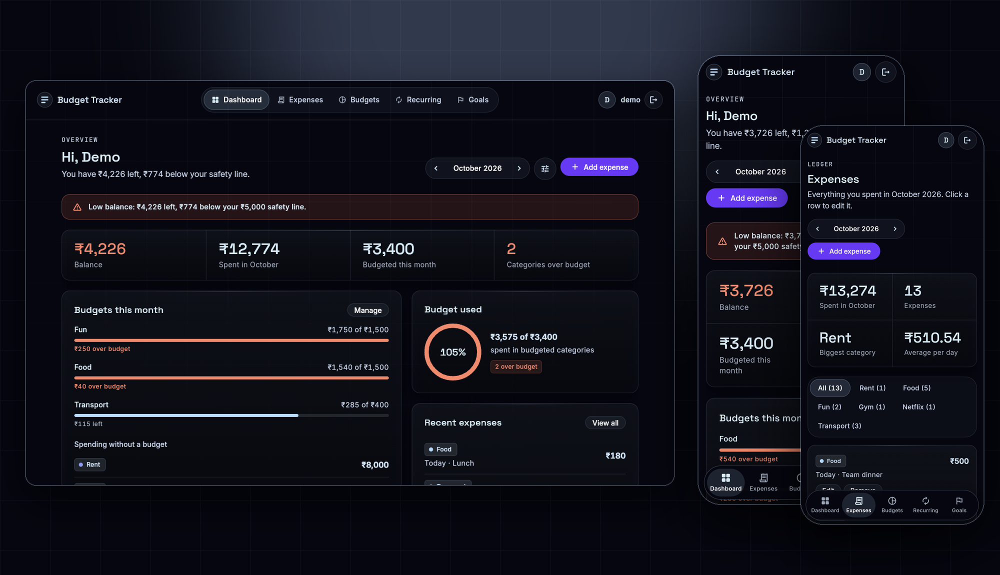

**[Live demo](https://budget-tracker-8n5q.onrender.com)** &nbsp;·&nbsp; [Try the guided tour](#take-the-tour) &nbsp;·&nbsp; [Run it yourself](#quick-start) &nbsp;·&nbsp; [API reference](#api-reference)

<sub>The live demo runs on a free tier that sleeps when idle: the first load can take up to a minute while it wakes up. Use the **Use demo account** button on the login screen.</sub>

</div>

> A prototype for a small number of users. Each person has their own account and sees only their own data. It is not built for scale.

## Contents

- [Highlights](#highlights)
- [Try the demo](#try-the-demo)
- [Take the tour](#take-the-tour)
- [Design](#design)
- [Architecture](#architecture)
- [System design](#system-design)
- [Data model](#data-model)
- [Frontend structure](#frontend-structure)
- [API reference](#api-reference)
- [Business rules](#business-rules)
- [Security and accounts](#security-and-accounts)
- [Testing](#testing)
- [Quick start](#quick-start)
- [Deployment](#deployment)
- [Project layout](#project-layout)
- [Screens](#screens)
- [License](#license)

## Highlights

| | |
| --- | --- |
| **Accounts** | Register, log in and out. Passwords are hashed with scrypt, sessions survive a reload, and every record belongs to one user. Another user's data is simply not there (404). |
| **Dashboard** | A one-line verdict ("You have ₹4,226 left, ₹774 below your safety line."), a low-balance banner, stats, budgets as bars, a budget-used ring, recent expenses and goals. |
| **Instant alerts** | Adding or editing an expense tells you straight away if it pushes a category over its budget or the balance under your safety line. |
| **Expenses** | A table of the month with filters, add, edit, and **Remove with Undo**. Categories are case-insensitive. |
| **Budgets, recurring, goals** | A monthly cap per category; templates (rent, subscriptions) applied to a month once, never twice; savings goals whose contributions reduce the balance. |
| **Exact money** | Amounts are integer paise in the database and rupees on the wire: no floating-point drift. Indian digit grouping (₹1,50,000). |
| **One image** | The Flutter web app and the API run from a single Docker image behind one port. Render rebuilds it on every push. |
| **Accessible and resilient** | Every control has a name for screen readers, text scales to 2x without overflow, and while a free-tier server wakes up the app waits and says so instead of failing. |

## Try the demo

The quickest way is the hosted build: open the **[live demo](https://budget-tracker-8n5q.onrender.com)**, click **Log in**, then **Use demo account**. (If the page says "Waking up the server…" give it up to a minute: the free tier sleeps when idle.)

To run it yourself, start the app as in [Quick start](#quick-start). With Docker the demo account already exists. From source, run `python backend/seed_demo.py` once the backend is up; it creates the account `demo` with the password `demo-password` (change them with `--username` and `--password`) and fills the current month through the public API:

| Seeded data | |
| --- | --- |
| Balance | ₹30,000 opening balance, ₹5,000 safety line |
| Budgets | Food ₹1,500, Fun ₹1,500, Transport ₹400 |
| Spending | Nine expenses over the last days, so Food and Fun are already over budget |
| Recurring | Rent, Netflix and Gym templates, already applied this month |
| Goals | Laptop (₹9,000 of ₹60,000) and Trip |

The script refuses to add data to an account that already has some (`--force` overrides that). **Reset the demo:** stop the backend, delete `backend/budget.db` (with Docker: `docker compose down -v`), start again and re-seed.

## Take the tour

Eleven steps, about five minutes, on the demo account. Every step below is also checked by [`e2e/demo_tour.py`](e2e/demo_tour.py), which performs the tour in a real browser and took the pictures you see here (see [Testing](#testing)).

### 1. Open the app and log in

The landing page explains the product. Click **Log in**, then **Use demo account**.

<table>
  <tr>
    <td width="33%"></td>
    <td width="33%"></td>
    <td width="33%">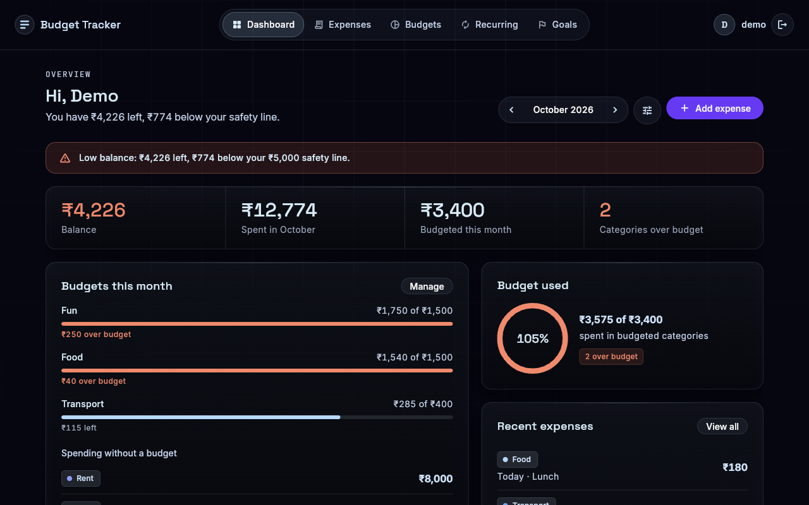</td>
  </tr>
</table>

### 2. Read the dashboard

The sentence at the top is the verdict: **"You have ₹4,226 left, ₹774 below your safety line."** The ember banner repeats it. *Food* (₹1,540 of ₹1,500) and *Fun* (₹1,750 of ₹1,500) have full bars marked "over budget"; *Transport* (₹285 of ₹400) still has room.

### 3. Change the opening balance

Click the sliders icon (**Balance settings**), set *Opening balance* to `40000` and **Save**. The warning goes away: **"You have ₹14,226 left, ₹9,226 above your safety line."**

<table>
  <tr>
    <td width="50%">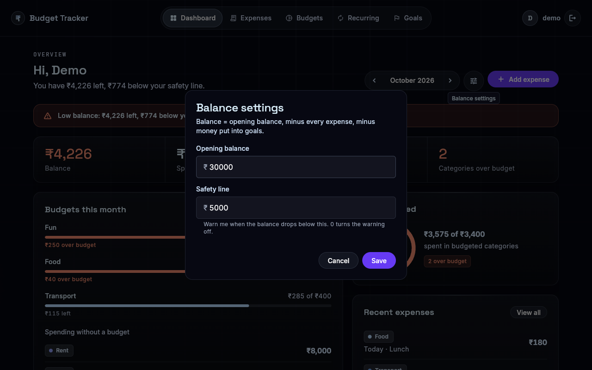</td>
    <td width="50%">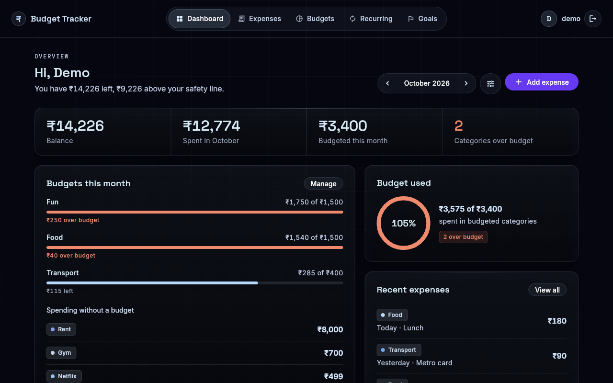</td>
  </tr>
</table>

### 4. Move between months

Use the arrows beside the month. Other months are empty; the arrows bring you back to this month.

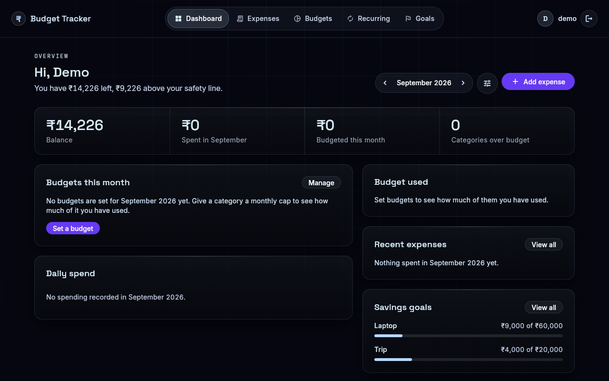

### 5. Add an expense and get an alert

Open **Expenses**, click **Add expense**, enter `500`, click the *Food* pill and **Save**. You are told at once: **"Over budget in food by ₹540"**.

<table>
  <tr>
    <td width="50%">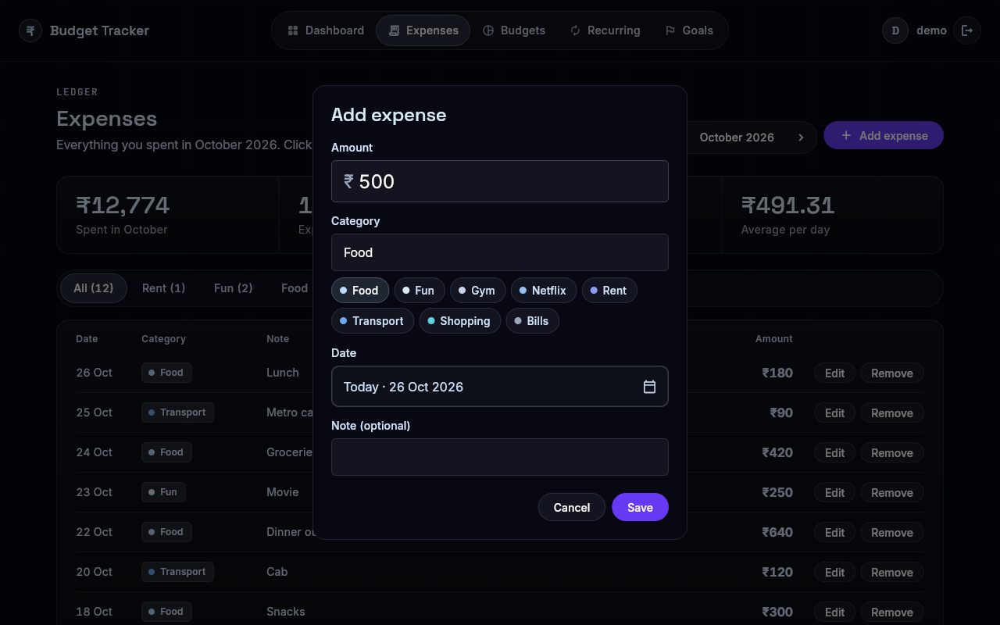</td>
    <td width="50%"></td>
  </tr>
</table>

### 6. Remove an expense, then undo it

Click **Remove** on the new row. It disappears at once and a message offers **Undo**. Click it and the row is back.

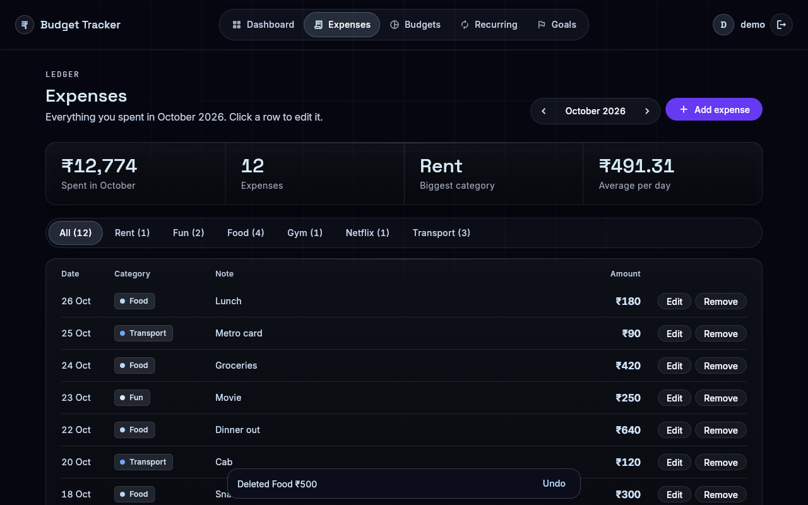

### 7. Edit an expense

Click **Edit** on a row (or the row itself) and change the amount to `300`. The expense is updated and the budget is checked again: **"Over budget in food by ₹340"**. When no budget is crossed, you see "Updated Food ₹300" instead.

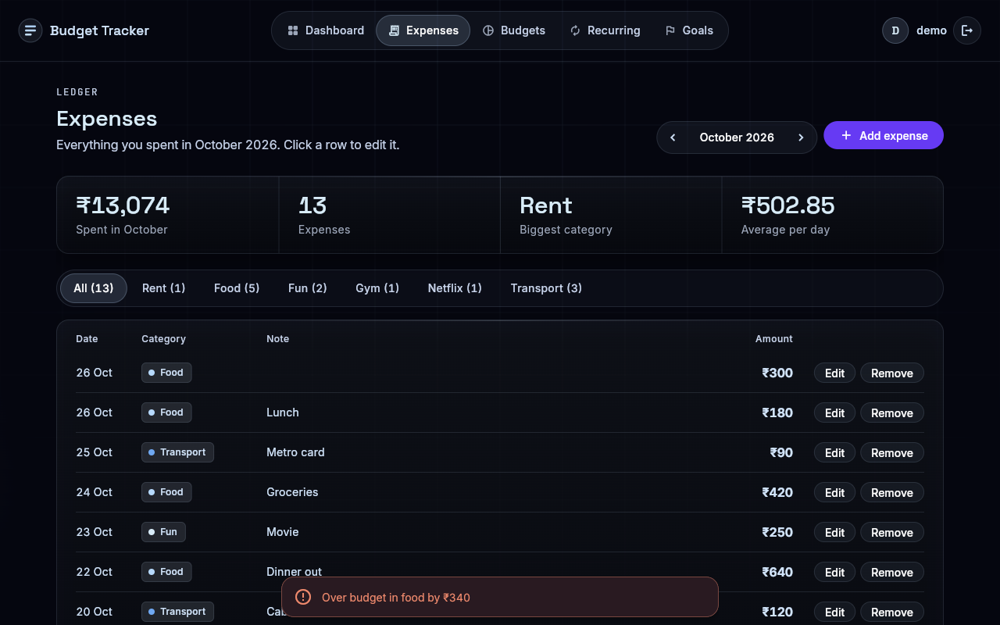

### 8. Raise a budget

Open **Budgets**, click **Change** on *Food*, set the cap to `3000` and **Save**. Add the same `500` expense again: this time there is no alert, only "Added Food ₹500".

<table>
  <tr>
    <td width="50%">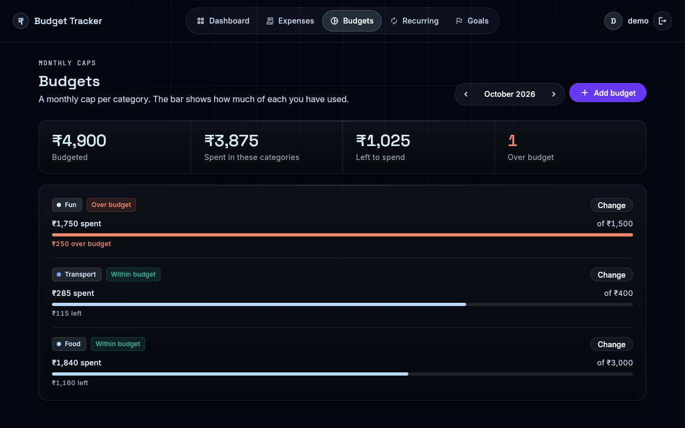</td>
    <td width="50%">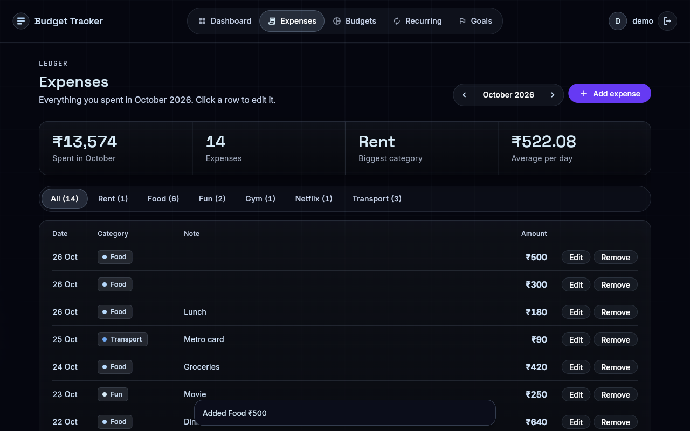</td>
  </tr>
</table>

### 9. Recurring expenses

Open **Recurring** and click **Apply to October 2026** (your current month). Rent, Netflix and Gym were already applied, so: **"Nothing to add: October 2026 is already up to date."** Applying twice never creates duplicates. Then click **Add template**, enter `100` / `Netflix` / day `31` and **Save**: the form stays open with **"Pick a day from 1 to 28"** (the day must exist in every month).

<table>
  <tr>
    <td width="50%">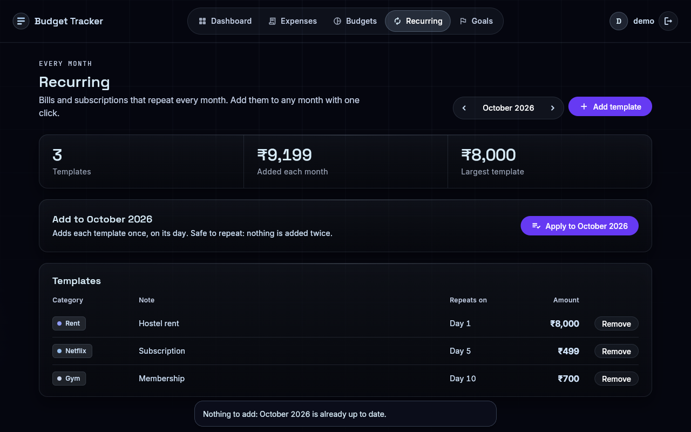</td>
    <td width="50%">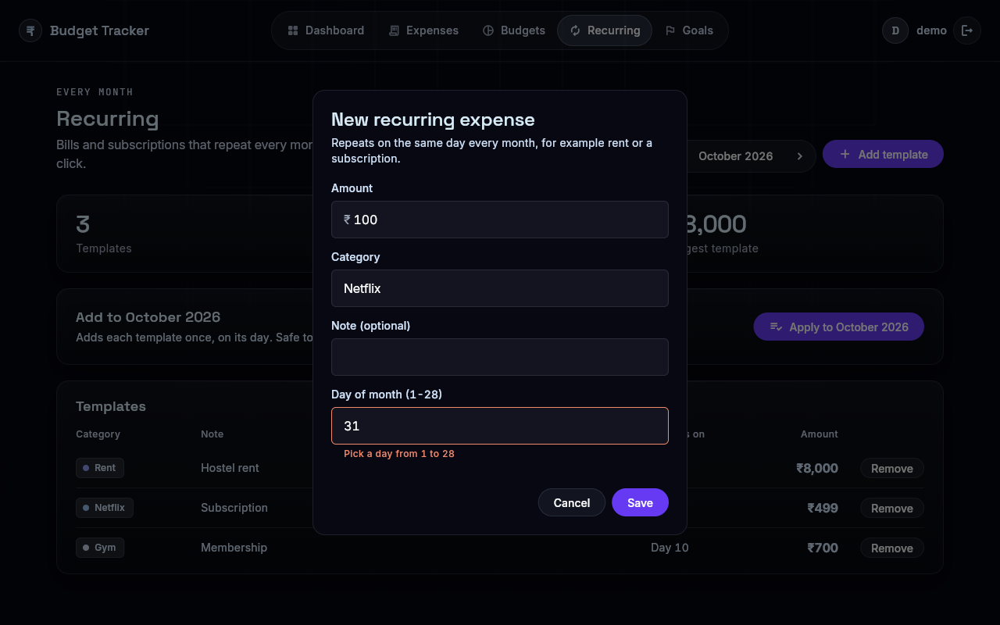</td>
  </tr>
</table>

### 10. Save towards a goal

Open **Goals** and click **Add money** on *Laptop*, then add `1000`. **"Added ₹1,000 to Laptop"**; progress moves to ₹10,000 of ₹60,000, and the money leaves your balance.

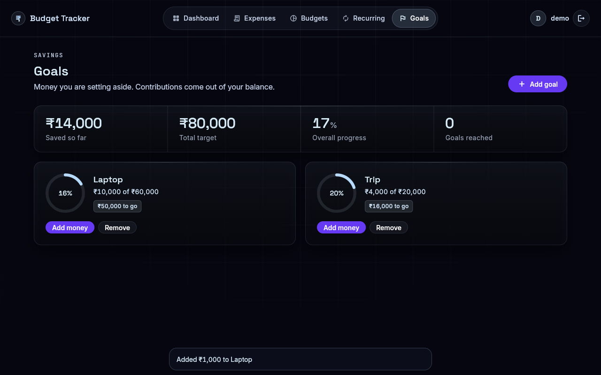

### 11. Log out

Click the log-out icon at the top right. You are back on the landing page, and the session is gone: a reload does not log you back in.

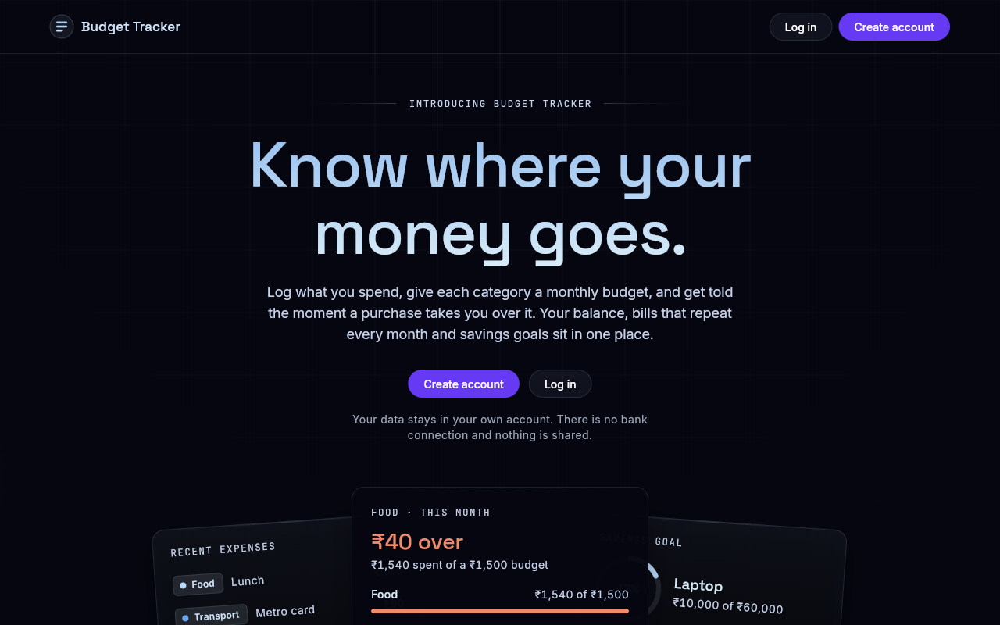

### Run the tour as a test

```bash
# a fresh database, the built app served by the backend, the demo account
cd backend && BUDGET_DB=/tmp/tour.db uvicorn main:app --port 8000     # leave running
python seed_demo.py                                                    # in another terminal

# the tour (desktop size; add VIEWPORT_W=390 VIEWPORT_H=844 for a phone)
BASE_URL=http://127.0.0.1:8000/ VIEWPORT_W=1280 VIEWPORT_H=800 python e2e/demo_tour.py
```

The tour changes the demo account, so use a fresh database each time. It exits non-zero if any step fails and rewrites `docs/img/tour/`.

## Design

A midnight glass interface: a near-black canvas with a faint blueprint grid and a spotlight from the top, frosted cards with hairline edges, pill buttons, and light that seems to come from behind the glass.

| | |
| --- | --- |
| **Canvas** | `#05060F` with a 1px grid at 80px cells that fades towards the edges, and a conic spotlight beam at the top centre |
| **Text** | Headline `#D8ECF8` → body `#D1E4FA` → muted `#C7D3EA` → helper `#9DA7BA`. The headline and the wordmark use a vertical ice-to-sky gradient (`#D8ECF8` → `#98C0EF`) |
| **Surfaces** | Cards are a 3% frost tint with a hairline `rgba(186,215,247,0.12)` edge and a bright top edge; dialogs and the sign-in card are near-opaque midnight with a deeper shadow |
| **Accent** | One violet, `#663AF3`, for the main action of a screen. Status uses ember `#E46D4C` (over budget, low balance, errors) and teal `#269684` (within budget) and nothing else |
| **Type** | Space Grotesk for headings, Inter for the interface, JetBrains Mono for the small tracked all-caps labels. All three are open source (SIL OFL) and bundled in `app/assets/fonts` |
| **Shape** | Buttons and navigation are pills; cards and dialogs have 16px corners; fields and tags 6px |
| **Navigation** | A glass pill across the top on wide windows; a floating pill at the bottom on phones |

Status is never colour alone: over-budget and low-balance also use words and icons. The app has no light theme by design.

## Architecture

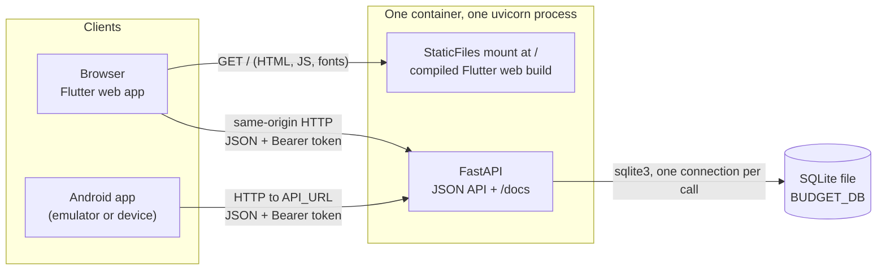

One process serves both the compiled web app at `/` and the JSON API, so the hosted build needs no CORS setup and no second service. The Flutter app reads its server address from the `API_URL` compile-time define (`--dart-define=API_URL=...`):

| `API_URL` | Base URL the app uses | Typical use |
| --- | --- | --- |
| `same-origin` | empty string (relative URLs) | The hosted build and the Docker image: the page and the API share one origin |
| not set, web build | `http://127.0.0.1:8000` | `flutter run -d chrome` against a local backend |
| not set, other platforms | `http://10.0.2.2:8000` | Android emulator (`10.0.2.2` is the host machine) |
| any other value | that value | A physical device (use the computer's LAN IP) or a remote server |

The API routes are registered first and the static mount last, so every API path wins and anything else is looked up as a file in the web build. If no `index.html` exists next to the API, the mount is skipped and `GET /` returns `{"name": "Budget Tracker API", "docs": "/docs"}` instead (this is what the backend tests exercise).

### Tech stack

| Layer | Technology | Version | Why |
| --- | --- | --- | --- |
| API | FastAPI | unpinned in `requirements.txt` | Typed request models, automatic validation errors and interactive docs at `/docs` |
| Validation | Pydantic v2 (installed with FastAPI) | follows FastAPI | `Decimal` amounts with a 2-decimal limit, regex and length constraints |
| Server | Uvicorn | unpinned | ASGI server; one process serves API and static files |
| Database | SQLite via the standard-library `sqlite3` | bundled with Python | Zero setup, one file, enough for a small number of users |
| Password hashing | `hashlib.scrypt` | standard library | Memory-hard KDF without a third-party dependency |
| Language runtime | Python | 3.10+ required (`X \| Y` type syntax); the Docker image uses 3.12 | |
| App | Flutter / Dart | Flutter 3.35.7 in the Docker build; Dart `>=3.0.0 <4.0.0` | One code base for web and Android, custom-drawn UI that looks the same everywhere |
| HTTP client | `http` | `^1.2.0` | Plain REST client; its `MockClient` makes hermetic UI tests possible |
| Local storage | `shared_preferences` | `^2.3.0` | Keeps the session token (browser local storage on web) |
| State management | Flutter built-ins (`ChangeNotifier`, `InheritedNotifier`) | | No state-management package needed |
| Lints | `flutter_lints` | `^4.0.0` (dev) | `flutter analyze` |
| Fonts | Inter, Space Grotesk, JetBrains Mono | bundled in `app/assets/fonts` (SIL OFL) | Works offline and renders identically on every platform |
| Backend tests | pytest + httpx (`TestClient`) | unpinned | In-process API tests against a temporary database |
| Browser tests | Playwright (Chromium) | installed separately with `pip install playwright` | Drives the real compiled app |
| Packaging | Docker (multi-stage), Docker Compose | `ghcr.io/cirruslabs/flutter:3.35.7`, `python:3.12-slim` | One image with app and API |
| Hosting | Render (Docker web service, free plan) | | Auto-deploys from `main` |

## System design

Six diagrams of the current system. Each has an editable SVG next to the PNG shown here, in [`docs/diagrams/`](docs/diagrams/).

### Data flow diagram: context

The user is the only external entity; the whole system is one process, with the credentials, inputs and session token going in and the lists, dashboard, alerts and error messages coming out.

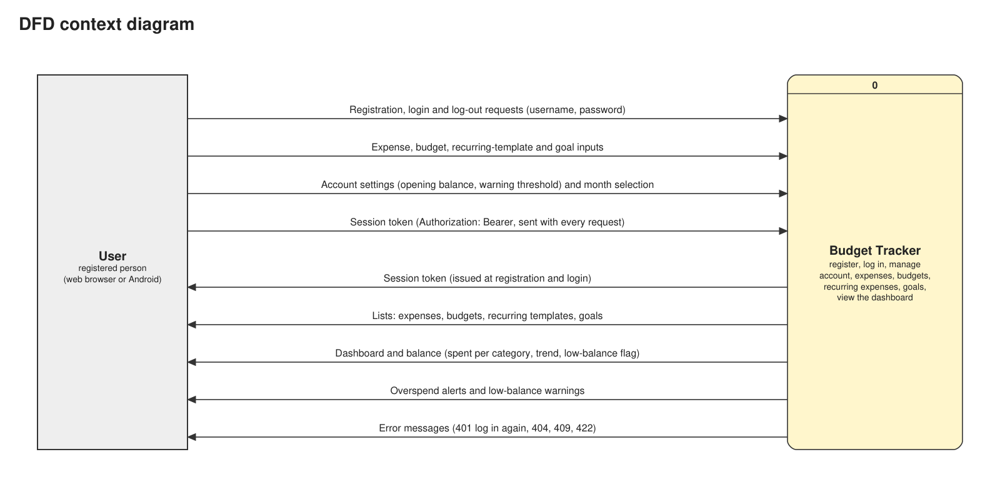

### Data flow diagram: level 1

Seven processes (authenticate, manage account, expenses, budgets, recurring and goals, and the balance and dashboard calculation) and seven data stores (users, sessions, account, expenses, budgets, recurring, goals), with every store access limited to the signed-in user's rows.

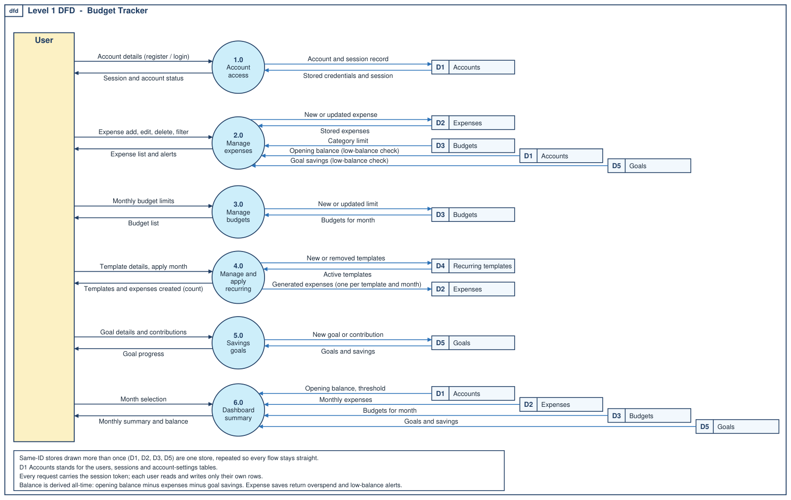

### UML use case diagram

What a registered user can do: register, log in and out, set the balance and warning threshold, add, edit, delete and filter expenses, set budgets, manage and apply recurring templates, manage goals and view the dashboard.

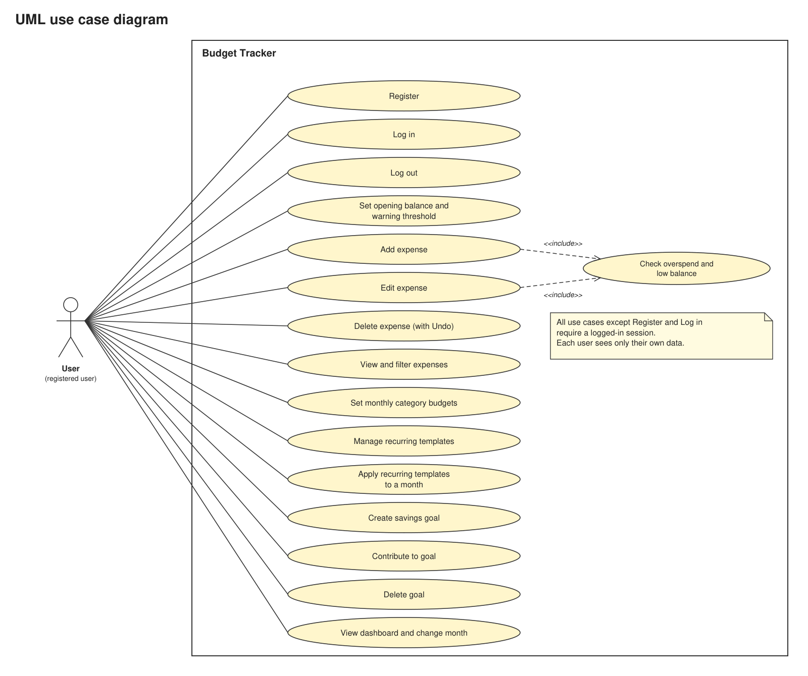

### UML component diagram

The Flutter app (screens, session state, token storage, API client) talks to the FastAPI application over HTTP and JSON with a bearer token; FastAPI reads and writes the SQLite file and also serves the compiled web app from the same origin.

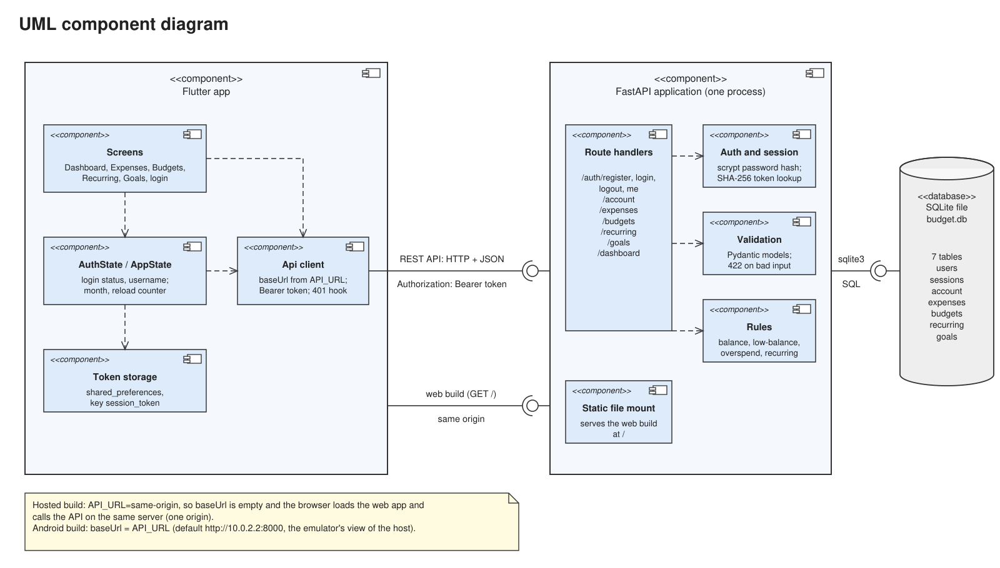

### UML sequence diagram: edit an expense

An edit from the dialog to the database: the bearer token is hashed and looked up in the sessions table, the update is limited to the user's own row, and the response carries the overspend alert and balance flags. The 401 and 404 outcomes are shown.

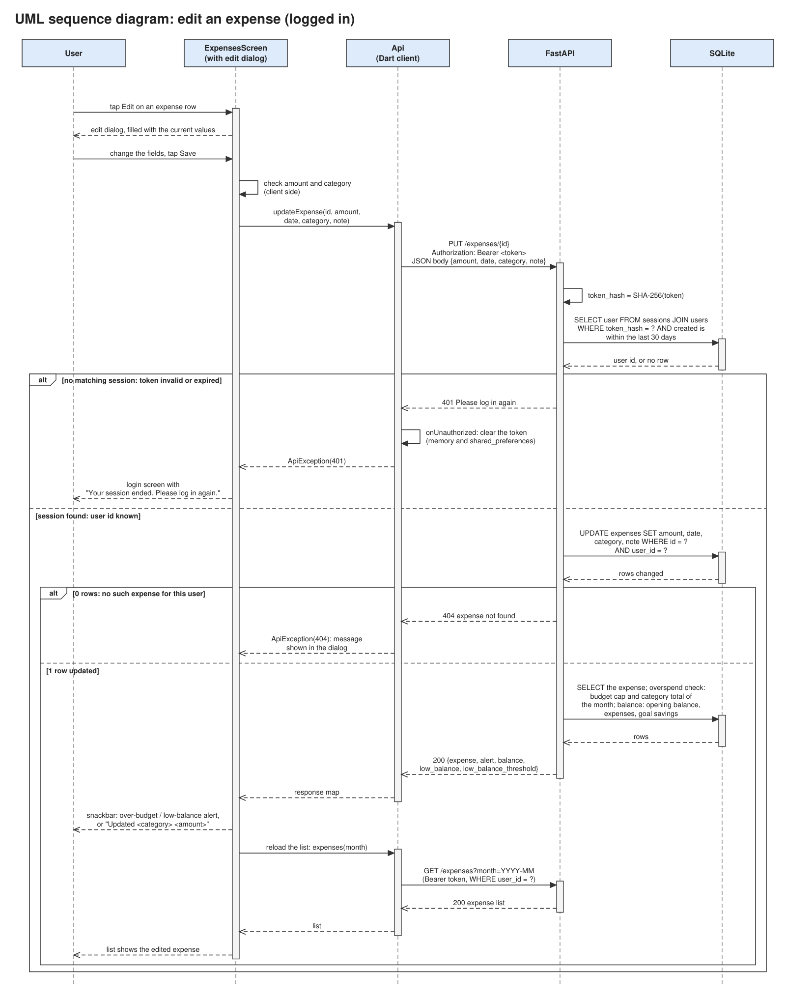

### UML activity diagram: apply recurring templates

What happens when a user applies recurring templates to a month: the token and month are validated, each of the user's templates is skipped if it already has an expense that month, otherwise an expense is inserted, and the app reports how many were created.

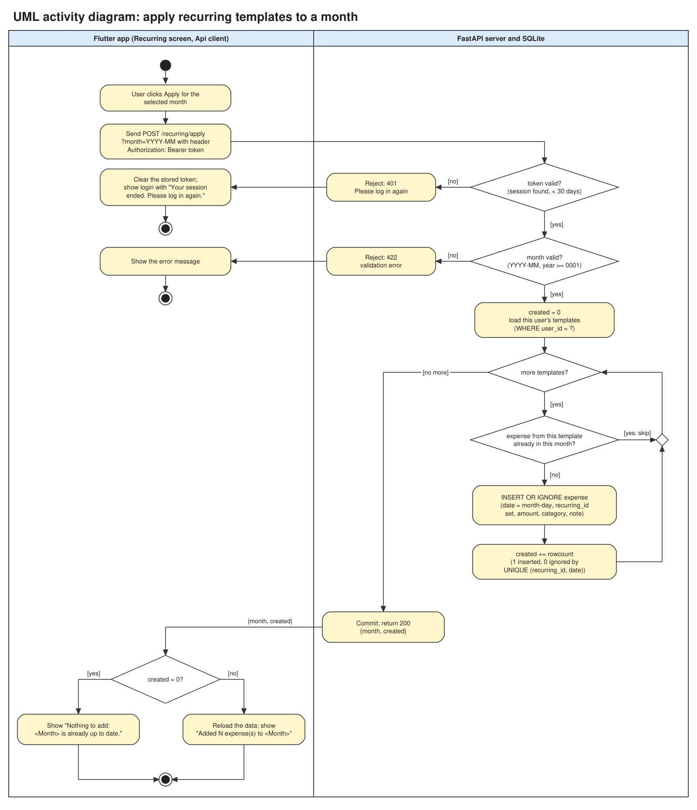

## Data model

All data lives in one SQLite file (`BUDGET_DB`). Foreign keys are switched on for every connection (`PRAGMA foreign_keys=ON`) and every data table cascades on user deletion. Tables are created with `CREATE TABLE IF NOT EXISTS` when the module is imported.

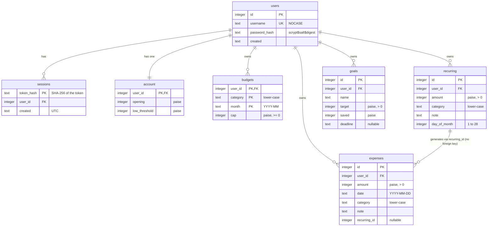

### Tables

| Table | Columns | Keys and constraints |
| --- | --- | --- |
| `users` | `id`, `username`, `password_hash`, `created` | `id` autoincrement primary key; `username` is `UNIQUE COLLATE NOCASE` (so `Alice` and `alice` collide) |
| `sessions` | `token_hash`, `user_id`, `created` | Primary key `token_hash`; `user_id` references `users` with `ON DELETE CASCADE`; `created` defaults to `CURRENT_TIMESTAMP` (UTC) |
| `account` | `user_id`, `opening`, `low_threshold` | Primary key `user_id` (exactly one row per user, created at registration); both amounts default to 0 |
| `expenses` | `id`, `user_id`, `amount`, `date`, `category`, `note`, `recurring_id` | `CHECK (amount > 0)`; `UNIQUE (recurring_id, date)`, which is what makes applying recurring templates idempotent (rows with `recurring_id` NULL never collide) |
| `budgets` | `user_id`, `category`, `month`, `cap` | Composite primary key `(user_id, category, month)`; `CHECK (cap >= 0)`; saved with an upsert |
| `recurring` | `id`, `user_id`, `amount`, `category`, `note`, `day_of_month` | `CHECK (amount > 0)`; `CHECK (day_of_month BETWEEN 1 AND 28)` so the day exists in every month |
| `goals` | `id`, `user_id`, `name`, `target`, `saved`, `deadline` | `CHECK (target > 0)`; `saved` starts at 0 and only grows by contributions; `deadline` is optional |

### Conventions

| Convention | Detail |
| --- | --- |
| Integer paise | Every amount is stored as an integer number of paise (1/100 rupee). Input is a `Decimal` limited to 2 decimal places (more is rejected with 422, never rounded), multiplied by 100 and stored as an integer. Responses divide by 100, so the API exposes amounts as JSON numbers in rupees (for example `60.1`). Sums are computed on integers in SQL, so `0.1 + 0.2` is exactly `0.3` |
| Categories are case-insensitive | Category names are trimmed and lower-cased on write (expenses, budgets, recurring templates) and the `category` filter on `GET /expenses` is lower-cased too. `Food`, `food` and `  FOOD ` are one category. The UI re-capitalises names for display. Goal names are stored as typed (trimmed) |
| Per-user scoping | Every data table has a `user_id`, and every query filters on the authenticated user's id. Budgets are unique per user, category and month, so two users can have the same category and month with different caps |
| Months | A month is a `YYYY-MM` string (`^\d{4}-(0[1-9]\|1[0-2])$`). An expense belongs to the month given by the first 7 characters of its date. Budgets are set per month and do not roll over |
| Dates | Stored as ISO `YYYY-MM-DD` text. The server accepts any valid date |
| Derived values | The balance, a goal's `progress` and the dashboard figures are computed on read; they are not stored |
| Compatibility | If an existing database file already holds an `expenses`, `budgets`, `recurring`, `goals` or `account` table without a `user_id` column, that table is renamed to `legacy_<name>` (data kept, never dropped, never read by the API) and the current table is created. This is covered by a backend test |

## Frontend structure

The app is a single Flutter code base in `app/lib` (13 files, no sub-folders). Platform folders (`android/`, `web/`, `windows/`) are generated with `flutter create` and are not part of the repository.

| File | Responsibility |
| --- | --- |
| `main.dart` | Entry point and `BudgetApp` (theme, background, `AuthScope`). A gate chooses the screen from the auth status: spinner or "Waking up the server" while restoring, error panel with Retry, the public area when logged out, or the app shell when logged in. Contains the `Shell`: five sections, the top pill nav on wide windows, the phone top bar and floating bottom pill, and system Back handling |
| `api.dart` | `baseUrl` from `API_URL`; the static `Api` client with one method per endpoint; `ApiException` (message and HTTP status); turns FastAPI error bodies (including the 422 list) into one readable message; sends the bearer token; calls `onUnauthorized` on any 401 from an authenticated call |
| `auth.dart` | `AuthState` (`loading`, `loggedOut`, `loggedIn`, `unreachable`): restore a saved session at start-up (with the wake-up retry), log in, register, log out, handle an ended session; persists the token; `AuthScope` |
| `auth_screen.dart` | Log in / Create account card with inline validation that mirrors the server rules, show-password toggle, autofill hints, and the optional "Use demo account" button |
| `landing.dart` | `PublicArea` (landing, login and register pages) and the landing page: nav, hero, feature cards, how-it-works, closing call to action, footer |
| `common.dart` | Formatting helpers (`money`, `monthLabel`, `dayLabel`, `titleCase`, keys), `AppState`/`AppScope`, `snack` and `confirm`, `DialogShell`, `showFormDialog`, `WakePolicy`, `isServerAsleep`, the generic `Loader`, `WakingPanel`, `ErrorState` |
| `theme.dart` | Design tokens (`Tk` theme extension), type styles, `buildTheme()`, category colours |
| `ui.dart` | Reusable components (see below) and the layout breakpoint |
| `dashboard.dart` | Overview: verdict sentence, low-balance banner, stat strip, budget bars, "budget used" ring, daily chart, recent expenses, goals preview; balance-settings dialog |
| `expenses.dart` | Add/edit expense dialog (category suggestions, date picker), expense table with category tabs, optimistic Remove with Undo |
| `budgets.dart` | Budget list with status tags and bars; add/change dialog (category is fixed when changing) |
| `recurring.dart` | Template list, add dialog, "Apply to <month>" action, Remove with Undo |
| `goals.dart` | Goal cards with progress rings, add goal, add money, confirmed delete |

### State management

There is no state-management package. Two `ChangeNotifier`s are exposed through `InheritedNotifier` scopes.

| Object | Scope | Holds |
| --- | --- | --- |
| `AuthState` | whole app (`AuthScope`) | Auth status, username, a notice such as "Your session ended. Please log in again.", a `waking` flag. Sets `Api.token` and `Api.onUnauthorized` |
| `AppState` | one logged-in session (`AppScope`) | Viewed month, open section index, and a `tick` counter. Any create, update or delete calls `changed()`, which bumps `tick`, and visible screens reload |
| `Loader<T>` | per screen | Runs a `load` future. Reloads when `loadKey` changes (the `tick`), and drops old data when `resetKey` changes (the month). While reloading it keeps the previous data on screen with a thin progress line; a failed refresh keeps the data and shows "Could not refresh. Showing the last data you loaded." |
| `WakePolicy` | global | Retry delays (see below), replaceable in tests |

`AppScope.of(context)` subscribes a widget; `AppScope.read(context)` reads without subscribing (used in callbacks). The logged-in subtree is created with `ValueKey(username)`, so a different account never inherits month, section or cached data from the previous one. Pull-to-refresh is available on every list screen.

### Behaviour while a free-tier server sleeps

Free hosting stops an idle service, and the first request can take up to a minute. The app treats "the server is not answering yet" (a network error, a timeout, or HTTP 502, 503 or 504) differently from a real error:

- At start-up with a saved token, and in every `Loader`, the call is retried after 2, 4, 6, 8, 10 and 12 seconds (about 42 seconds of waiting) and a "Waking up the server..." panel explains the delay.
- If the retries run out, a "Could not reach the server" panel with a Retry button is shown. Other errors (404, 500 and so on) are not retried.
- Log in and register are not retried; a network failure shows "Could not reach the server. Check your connection and try again."
- A 401 on any authenticated call (expired or revoked token) clears the token and returns to the login screen with the notice "Your session ended. Please log in again."

### Navigation

| Window width | Layout |
| --- | --- |
| 760 logical pixels and wider (`kWideBreakpoint`) | A top bar: logo on the left, a floating glass pill with the five sections in the centre, avatar, user name (shown from 1060 px) and a log-out button on the right. Content is centred, at most 1200 px wide |
| Narrower | A slim top bar (logo, avatar, log out) and a floating bottom pill with icon-over-label tabs for the five sections |

Sections are Dashboard, Expenses, Budgets, Recurring and Goals. Switching sections cross-fades in 180 ms (no animation when the system asks for reduced motion). System Back from any other section returns to the Dashboard first. The month switcher (previous/next) is shared by Dashboard, Expenses, Budgets and Recurring.

### Design system

The app is dark only. Tokens live in `Tk` (a `ThemeExtension`, read with `context.tk`) in `theme.dart`.

| Group | Tokens |
| --- | --- |
| Palette | Midnight `#05060F` (page), steel `#2F343E`, fog `#9DA7BA`, mist `#C7D3EA`, frost `#D1E4FA`, ice `#D8ECF8`, ice deep `#98C0EF`, violet `#663AF3` (the one accent, primary buttons), blueprint `#B6D9FC` (links), ember `#E46D4C`, signal `#027DEA`, teal `#269684` |
| Text steps | `ink` ice, `ink2` frost, `ink3` mist, `ink4` fog (headline down to helper text) |
| Surfaces | Cards are a barely visible frost tint (`rgba(186, 215, 247, 0.03)` to `0.055`) over the canvas; dialogs and the sign-in card use `deep` (near-opaque midnight). Hairline edges are `rgba(186, 215, 247, 0.12)` and `0.24` (focus and emphasis) |
| Status | Within budget `#3FBFA8`; over budget and low balance `#F08A6D` (both warning and error use the same ember tone, backed by words and icons) |
| Fonts | `UntitledSans` for body and interface (Inter 400/500/600/700), `Aeonik` for display headings (Space Grotesk 400/500), `DotDigital` for tracked all-caps labels (JetBrains Mono 400). Tabular figures are on for every style so amounts align |
| Type scale | 48 and 44 (hero), 28 (page title), 24, 18 (panel heading), 16 and 14 (body), 12 (labels, tags) |
| Radii | 16 for panels, dialogs and snackbars; 12 for alerts and menus; 6 for inputs, tags and the squared sign-in button; fully rounded pills for buttons and navigation |
| Background | `Atmosphere`: midnight canvas, a faint 80 px blueprint grid fading toward the edges, and a spotlight beam from the top centre |
| Category colours | A 9-step ramp of cool blues and teal. Known names (food, transport, rent, fun and so on) map to fixed colours; other names are assigned by a stable hash, case-insensitively |

Components in `ui.dart`:

| Component | Purpose |
| --- | --- |
| `Panel`, `PanelTitle` | Glass card with a hairline edge and a bright top edge; `deep` variant for dialogs |
| `PageHead`, `Eyebrow` | Page title block with eyebrow label, one-line description and actions; the eyebrow drops its flanking lines when large text leaves no room |
| `StatStrip`, `Stat` | One panel divided into figures (wraps to two per row on narrow widths) |
| `Btn` (primary, ghost, hl, danger), `IconBtn`, `IconTile` | Buttons with busy state and optional spoken label override; icon buttons always carry a tooltip |
| `LabeledField` | Label above a text field with error and helper text, numeric filter (`0-9` and `.`), `₹` prefix, autofill hints |
| `Tag`, `CategoryTag` | Small status and category labels |
| `Ring`, `BarRow`, `DailyChart` | Percentage ring, labelled progress bar, per-day spending columns with a text summary |
| `SegTabs` | Pill segmented control (category filter, login/register switch) |
| `Alert`, `Banner2`, `EmptyPanel` | Inline message strip, full-width low-balance banner, empty state with a first step |
| `MonthSwitcher`, `Avatar`, `Logo`, `GradientText` | Month navigation, initial avatar, wordmark, gradient headline text |

### Accessibility

| Measure | Where |
| --- | --- |
| Screen-reader names | Every control is reachable by name. Repeated buttons carry specific labels such as `Remove Food ₹150` or `Add money to Laptop`; icon buttons use their tooltip as label |
| Structure | Page, panel and dialog titles are marked as headers; navigation is a labelled region (`Main navigation`) with the selected item flagged |
| Live regions | Alerts, the low-balance banner and the month label announce changes |
| Not colour alone | Over-budget, low-balance and goal-reached states also use text and icons ("Over budget", "Close to limit", "Goal reached") |
| Decorative elements | Background, logo mark, avatar, rings, bars and icon tiles are excluded from the semantics tree; the daily chart exposes one text summary ("Highest day: ...") |
| Reduced motion | Ring, bar and chart animations and the section cross-fade are skipped when the system disables animations |
| Large text | Layouts reflow for large system text; automated tests run the screens at 2x text scale and fail on overflow |
| Forms | Inline error text per field, numeric keyboard and input filtering, autofill hints for username and password, password show/hide, default focus on the first field, Enter submits the last field |
| Target size | Buttons are at least 44 px high (34 px for the compact variant); icon buttons are 36 to 44 px |

### Build-time defines

| Define | Default | Effect |
| --- | --- | --- |
| `API_URL` | see [Architecture](#architecture) | Server address |
| `SHOW_DEMO` | `false` | Shows a "Use demo account" button on the login screen that signs in as `demo` / `demo-password` |

For Android release builds, `python app/tool/patch_android.py` (run from `app/` after `flutter create`) adds the `INTERNET` permission to the generated manifest, and `--cleartext` additionally allows plain `http://` APIs. It can be run repeatedly.

## API reference

Base URL: the server root (`http://localhost:8000` locally). Interactive docs: `/docs` (Swagger UI), `/redoc`, schema at `/openapi.json`. All bodies are JSON. Errors are `{"detail": "..."}`; validation errors (422) carry FastAPI's list form `{"detail": [{"loc": [...], "msg": "...", "type": "..."}]}`. "Auth" means `Authorization: Bearer <token>` is required.

| Method | Path | Auth | Request | Response | Notable errors |
| --- | --- | --- | --- | --- | --- |
| POST | `/auth/register` | no | `username` (3-30, `A-Za-z0-9_.-`), `password` (8-128) | `201` `{token, username}`; also creates the user's `account` row | `409` "That username is already taken"; `422` |
| POST | `/auth/login` | no | `username` (1-100), `password` (1-128) | `200` `{token, username}` (stored casing) | `401` "Wrong username or password" |
| POST | `/auth/logout` | yes | none | `204`, current token deleted | `401` |
| GET | `/auth/me` | yes | none | `{username}` | `401` |
| GET | `/account` | yes | none | `{opening_balance, balance, low_balance_threshold, low_balance}` | `401` |
| PUT | `/account` | yes | `opening_balance` (>= 0), `low_balance_threshold` (>= 0) | Same shape as `GET /account` | `422` |
| POST | `/expenses` | yes | `amount` (> 0, 2 dp), `date` (ISO), `category`, `note` (default `""`) | `201` `{expense, alert, balance, low_balance_threshold, low_balance}`; `expense` is `{id, amount, date, category, note, recurring_id}`; `alert` is `null` or `{category, month, cap, spent, over_by}` | `422` |
| GET | `/expenses` | yes | query `month` (`YYYY-MM`, optional), `category` (optional, case-insensitive) | Array of expense objects, newest date first, then newest id | `422` bad month |
| PUT | `/expenses/{expense_id}` | yes | Same body as `POST /expenses` | `200`, same shape as the POST response (the alert is re-checked for the new category and month) | `404` "expense not found"; `422` |
| DELETE | `/expenses/{expense_id}` | yes | none | `204` | `404` "expense not found" |
| PUT | `/budgets` | yes | `category`, `month`, `cap` (>= 0, 2 dp) | `{category, month, cap}`; inserts or updates the cap for that user, category and month | `422` |
| GET | `/budgets` | yes | query `month` (required) | Array of `{category, month, cap}` ordered by category | `422` missing or bad month |
| POST | `/recurring` | yes | `amount` (> 0), `category`, `note`, `day_of_month` (1-28) | `201` `{id, amount, category, note, day_of_month}` | `422` |
| GET | `/recurring` | yes | none | Array of templates ordered by id | |
| DELETE | `/recurring/{rid}` | yes | none | `204`. Expenses already created from it are kept | `404` "template not found" |
| POST | `/recurring/apply` | yes | query `month` (required) | `{month, created}`: the number of expenses newly inserted. Calling again returns `created: 0` | `422` |
| POST | `/goals` | yes | `name`, `target` (> 0), `deadline` (ISO date or null) | `201` `{id, name, target, saved, deadline, progress}` | `422` |
| GET | `/goals` | yes | none | Array of goals ordered by id | |
| POST | `/goals/{gid}/contribute` | yes | `amount` (> 0) | `{goal, balance, low_balance_threshold, low_balance}` | `404` "goal not found"; `422` |
| DELETE | `/goals/{gid}` | yes | none | `204`; the saved amount returns to the balance because the balance is derived | `404` "goal not found" |
| GET | `/dashboard` | yes | query `month` (required) | `{month, total_spent, categories: [{category, spent, cap, over}], trend: [{date, total}], balance, low_balance_threshold, low_balance}` | `422` |
| GET, HEAD | `/` | no | none | The web app's `index.html` when a web build is present; otherwise `{"name": "Budget Tracker API", "docs": "/docs"}`. Also used as the host health check | |

Response details worth knowing:

- `categories` in the dashboard is the union of categories that have spending or a cap in that month, sorted by name. `cap` is `null` when no budget exists; `over` is `true` only when a cap exists and `spent > cap`.
- `trend` has one entry per day that has spending (no zero days), ordered by date.
- `progress` on a goal is `saved / target`, capped at `1.0` and rounded to 4 decimal places.
- Deleting something returns `204` with no body. There is no endpoint to update a budget's category, edit a goal or template, delete a budget, withdraw from a goal or delete an account.

### Examples

Register (the response contains the session token; `$TOKEN` below is that value):

```bash
curl -s -X POST http://localhost:8000/auth/register \
  -H "Content-Type: application/json" \
  -d '{"username": "asha", "password": "correct horse"}'
```

```json
{"token": "Qm3xk0T8vXr1Zb7uYk2sN4pLw9aHc5dEoJf6gIiRtUA", "username": "asha"}
```

Log in later (case-insensitive username):

```bash
curl -s -X POST http://localhost:8000/auth/login \
  -H "Content-Type: application/json" \
  -d '{"username": "ASHA", "password": "correct horse"}'
```

```json
{"token": "e7Vn2LqH0sKcR4yTzW8bUo1XjMd5GfAi3PuNxYtB6Ek", "username": "asha"}
```

Add an expense. This example assumes the user first ran `PUT /account` with `{"opening_balance": 30000, "low_balance_threshold": 5000}` and `PUT /budgets` with `{"category": "Food", "month": "2026-10", "cap": 500}`. The response includes the overspend alert and the new balance:

```bash
curl -s -X POST http://localhost:8000/expenses \
  -H "Authorization: Bearer $TOKEN" \
  -H "Content-Type: application/json" \
  -d '{"amount": 640, "date": "2026-10-24", "category": "Food", "note": "Dinner out"}'
```

```json
{
  "expense": {"id": 1, "amount": 640.0, "date": "2026-10-24", "category": "food",
              "note": "Dinner out", "recurring_id": null},
  "alert": {"category": "food", "month": "2026-10", "cap": 500.0,
            "spent": 640.0, "over_by": 140.0},
  "balance": 29360.0,
  "low_balance_threshold": 5000.0,
  "low_balance": false
}
```

Dashboard for the month:

```bash
curl -s "http://localhost:8000/dashboard?month=2026-10" \
  -H "Authorization: Bearer $TOKEN"
```

```json
{
  "month": "2026-10",
  "total_spent": 640.0,
  "categories": [
    {"category": "food", "spent": 640.0, "cap": 500.0, "over": true}
  ],
  "trend": [
    {"date": "2026-10-24", "total": 640.0}
  ],
  "balance": 29360.0,
  "low_balance_threshold": 5000.0,
  "low_balance": false
}
```

## Business rules

| Rule | Behaviour in the code |
| --- | --- |
| Balance | `balance = opening balance - sum of all expenses - sum of all goal savings`, over all time and not just the viewed month, in integer paise. Expenses dated in the future count immediately. The balance can become negative; nothing blocks an expense that would overdraw it |
| Low-balance warning | `low_balance` is `true` when `low_balance_threshold > 0` and `balance < threshold` (strictly below). A threshold of 0 turns the warning off. It is returned with every response that changes the balance (add or update expense, contribute) and with `/account` and `/dashboard` |
| Overspend alert | After an expense is added or updated, the server sums that user's spending in the expense's category and month. If a budget exists for that category and month and `spent > cap` (strictly), `alert` is `{category, month, cap, spent, over_by}`; otherwise `null`. The sum covers the whole category-month, so every further expense while over budget alerts again. Deleting an expense returns no alert. Changing a cap later does not alert; the dashboard's `over` flag reflects it |
| Editing an expense | The update re-checks the budget for the new category and month (an edit can push a category over its cap) |
| Budgets | One cap per user, category and month, saved with an upsert. A cap of 0 is allowed. Budgets do not carry over to the next month |
| Recurring templates | A template stores amount, category, note and a day of month from 1 to 28. It does nothing until applied |
| Applying templates | `POST /recurring/apply?month=YYYY-MM` inserts one expense per template dated `<month>-<day>`, with `recurring_id` set, using `INSERT OR IGNORE` on `UNIQUE (recurring_id, date)`. Repeating the call inserts nothing (`created: 0`). Applying another month creates that month's expenses. The amount and note are copied at apply time, so later template changes do not affect existing expenses. Deleting a template keeps its generated expenses |
| Idempotence limits | Idempotence is per `(template, date)`. If a generated expense is deleted, applying again re-creates it; if it is edited to another date, applying again adds a new one for the original date |
| Goals | A goal has a positive target and starts at 0 saved. `POST /goals/{id}/contribute` adds to `saved` and therefore lowers the balance. Contributions may exceed the target (progress is capped at 100% but `saved` is not). Deleting a goal gives its saved amount back to the balance. The optional `deadline` is stored and returned by the API; the app does not currently offer a field for it |
| Dashboard month | Spending, caps and trend are filtered to the requested month. The balance is not month-specific. `total_spent` sums all categories in the month, with or without a budget |
| Validation | Amounts, targets and contributions must be greater than 0; caps and balances 0 or more; at most 2 decimal places; blank category or goal names are rejected after trimming; months must be `YYYY-MM` with a month from 01 to 12; day of month 1 to 28. Violations return 422 and nothing is written |
| Display | The app shows amounts as rupees with Indian digit grouping and drops the decimals when there are no paise (`₹1,50,000`, `₹4,226.50`). It marks a bar amber from 85% of the cap and red above 100% |

## Security and accounts

| Topic | Implementation |
| --- | --- |
| Password hashing | `hashlib.scrypt` with `n=2**14`, `r=8`, `p=1` and a fresh 16-byte random salt (`secrets.token_bytes(16)`) per user. Stored as `scrypt$<salt hex>$<digest hex>`; the plain password is never stored or logged. The cost parameters are fixed in code, not stored with the hash |
| Password check | Recomputes the digest with the stored salt and compares with `hmac.compare_digest` (constant time) |
| No username oracle | Login runs the same scrypt computation against a dummy hash when the username does not exist, and a wrong password and an unknown username return the identical `401 {"detail": "Wrong username or password"}` |
| Session tokens | `secrets.token_urlsafe(32)` (256 bits of randomness). Only the SHA-256 hex digest is stored in `sessions.token_hash`, so a leaked database does not reveal usable tokens |
| Session lifetime | 30 days (`SESSION_DAYS`), measured from the token's creation (fixed, not sliding). A request is authenticated only if the row exists and `created >= now - 30 days`. Expired rows are ignored but not deleted |
| Logout | `POST /auth/logout` deletes the presented token's row. Other sessions of the same user stay valid |
| Authorization header | `Authorization: Bearer <token>`. A missing header, a malformed header, an unknown token and an expired token all return `401 {"detail": "Please log in again"}` with `WWW-Authenticate: Bearer` |
| Which endpoints need it | Everything except `POST /auth/register`, `POST /auth/login`, `GET/HEAD /` and the docs/static files. Every data endpoint is covered by a parametrised test that checks 401 without and with a bad token |
| Per-user isolation | Reads add `WHERE user_id=?`. Updates and deletes use `WHERE id=? AND user_id=?`. If no row matches, the API answers `404` (not 403), so another user's record ids are indistinguishable from ids that do not exist |
| Usernames | Trimmed, 3 to 30 characters, only `A-Za-z0-9_.-`, unique case-insensitively. Login matches case-insensitively and returns the name with its stored casing |
| Passwords | Registration: 8 to 128 characters. Login: 1 to 128 characters |
| Money fields | `amount`, `target` and contribution `amount` must be greater than 0; `cap`, `opening_balance` and `low_balance_threshold` must be 0 or more; at most 2 decimal places everywhere |
| Text fields | `category` and goal `name` are trimmed and must not be blank. `day_of_month` must be 1 to 28. `month` must match the month pattern. SQL always uses bound parameters |
| CORS | `CORSMiddleware` with `allow_origins=["*"]`, all methods, all headers. Credentials (cookies) are not allowed and not used: authentication is a bearer header, so there is no ambient browser credential for another site to ride on |
| Token storage in the app | The token is kept with `shared_preferences` (browser local storage on web, app storage on Android) so a reload does not log the user out. If storage is unavailable, the session lasts until the tab closes |

### What is deliberately not done

| Not implemented | Consequence |
| --- | --- |
| Rate limiting or lockout | Nothing slows repeated login or registration attempts. Put a rate-limiting proxy in front for anything public |
| Email, password reset, account recovery | Accounts have no email address. A forgotten password cannot be recovered |
| Change password, delete account | There are no endpoints for either |
| Session revocation of all devices | Logout only ends the current token |
| TLS | The app does not terminate HTTPS. Render provides it; behind another host, add it at the proxy |
| Upper limits on amounts and text length | Amounts above roughly 9.2e16 rupees overflow SQLite's 64-bit integer and the request fails with a 500. `note`, `category` and goal `name` have no maximum length |
| Token in local storage | Like any browser app that keeps a bearer token in local storage, a script injection bug would expose it. The app renders no user-supplied HTML |
| Pinned dependencies | `requirements.txt` lists unpinned packages (and test packages are installed into the runtime image too) |
| Purging expired sessions | Old `sessions` rows accumulate; they are rejected but never removed |

## Testing

| Layer | Location | Count | Needs | What it covers |
| --- | --- | --- | --- | --- |
| Backend API tests | `backend/test_main.py` | 55 test cases (parametrised cases counted) | Nothing running; uses a temporary SQLite file | Register, login, logout, session expiry; hashing and salting; uniform login failures; 401 on every data endpoint; per-user isolation and 404s; expense, budget and dashboard flow; overspend alert and editing; low balance and goals; recurring idempotence; month, name, amount-precision and account validation; serving the web app next to the API; handling of a database that holds older unowned tables |
| Dart format tests | `app/test/format_test.dart` | 9 | Nothing | Money formatting (Indian grouping, paise, minus sign), day/month labels, title case, category colours |
| Dart widget tests | `app/test/widget_test.dart` | 2 | Nothing | Logged-out start shows the landing page; Log in opens the form |
| Dart UI-flow tests | `app/test/ui_flow_test.dart` | 55 in 9 groups | Nothing (an in-memory stub of the API via `MockClient`) | Public pages; accounts (login, register validation, wrong password, taken username, unreachable server, logout, ended session); waking-server retries; dashboard; expenses (add, edit, alerts, Remove/Undo, filters); budgets; recurring; goals; shell navigation (wide and phone); 2x text scale on every screen |
| Dart API-client tests | `app/test/api_test.dart` | 6 | A running backend and `--dart-define=API_URL` | The `Api` client against the real server: accounts, login required, user isolation, a full feature flow, error surfacing. Registers its own throwaway users, so it can be repeated on any database |
| API sweep | `e2e/api_sweep.py` | about 420 checks | A running backend (local or hosted) | Every endpoint with valid and invalid input, isolation, concurrency, limits; `python e2e/api_sweep.py http://127.0.0.1:8000` |
| Demo tour | `e2e/demo_tour.py` | 30 `step(...)` checks | The same as the walkthrough, plus a freshly seeded demo account | The [guided tour](#take-the-tour) above, step by step on the demo account, saving the screenshots in `docs/img/tour/`. Passes at desktop and phone size |
| Browser walkthrough | `e2e/walkthrough.py` | 61 `step(...)` checks | Compiled web app served by the backend, Playwright + Chromium | Landing, login and registration validation, every section, add/edit/remove with Undo, alerts, recurring applied twice, goals, logout/login, reload keeps the session, a second user sees none of the first user's data, no console errors (CORS, fetch, uncaught) |

Flutter totals: about 80 tests, 74 of which need no backend (format, widget, UI-flow and timeout tests). The UI-flow tests run at 1200 x 1000 by default and at 400 x 900 where a test asks for a phone.

Commands:

```bash
# 1. Backend
cd backend
pip install -r requirements.txt
pytest

# 2. Flutter: static analysis and the tests that need no backend
cd app
flutter pub get
flutter analyze
flutter test test/format_test.dart test/widget_test.dart test/ui_flow_test.dart

# 3. Flutter: everything, including the API-client tests
#    (start a throwaway backend first, in another terminal)
cd backend && BUDGET_DB=/tmp/t.db uvicorn main:app --port 8000
cd app && flutter test --dart-define=API_URL=http://127.0.0.1:8000

# 4. Browser walkthrough (needs: pip install playwright && playwright install chromium)
cd app && flutter build web --dart-define=API_URL=same-origin --dart-define=SHOW_DEMO=true
cp -r build/web ../backend/web                 # Windows: xcopy /E /I build\web ..\backend\web
cd ../backend && uvicorn main:app --port 8000   # leave running
cd .. && BASE_URL=http://127.0.0.1:8000/ python e2e/walkthrough.py
```

`api_test.dart` must be given `API_URL`: without it, tests run with the non-web default (`http://10.0.2.2:8000`), which does not exist on a development machine.

Walkthrough settings (environment variables, defined in `e2e/common.py`):

| Variable | Default | Meaning |
| --- | --- | --- |
| `BASE_URL` | `http://127.0.0.1:8000/` | Address of the running app |
| `VIEWPORT_W`, `VIEWPORT_H` | `390`, `844` | Window size (phone). Use `1280` and `800` for the desktop layout |
| `SHOTS` | `e2e-shots` | Folder for screenshots (also written on a failing step) |
| `BROWSER_CHANNEL` | empty | Set to `chrome` to use an installed Chrome instead of Playwright's Chromium |
| `SLOW` | `1` | Multiplier for waits on slow machines |
| `COLOR_SCHEME` | `dark` | Browser colour-scheme preference (the app itself is dark only) |

The walkthrough exits non-zero if any step fails, and registers fresh users on each run. Flutter draws to a canvas, so the script turns on Flutter's accessibility layer and finds every control by its accessible name rather than by coordinates. `e2e/demo_tour.py` and `e2e/screenshots.py` use the same helpers to capture the README screenshots of the demo account (run `python backend/seed_demo.py` first; settings `BASE_URL`, `SHOTS`, `DEMO_USER`, `DEMO_PASSWORD`).

## Quick start

Prerequisites: Python 3.10+, Flutter 3.35+ (Dart 3) and Chrome. Docker is optional.

### Fastest: Docker

```bash
docker compose up --build
```

Open http://localhost:8000. The container serves the app and the API on one port, creates the `demo` account on start, and keeps data in the `budget-data` volume. API docs are at http://localhost:8000/docs.

### From source

```bash
# 1. Backend (terminal 1)
cd backend
pip install -r requirements.txt
uvicorn main:app --port 8000

# 2. Demo data (terminal 2): the account demo / demo-password
python seed_demo.py

# 3. The app (terminal 3). The platform folders are generated, not committed.
cd app
flutter create . --project-name budget_tracker --platforms=web
python tool/patch_web.py          # the app's own title, colours and icons
flutter pub get
flutter run -d chrome --dart-define=API_URL=http://127.0.0.1:8000 --dart-define=SHOW_DEMO=true
```

`--dart-define=SHOW_DEMO=true` adds the **Use demo account** button to the login screen. The default `API_URL` is `http://10.0.2.2:8000`, which is how an Android emulator reaches the host machine.

<details>
<summary><b>Android and other builds</b></summary>

`flutter create` only grants the `INTERNET` permission to *debug* builds, so a release APK cannot reach the API. After generating the platform folders:

```bash
cd app
flutter create . --project-name budget_tracker --platforms=web,android,windows
python tool/patch_android.py --cleartext      # network access, app name and icon; --cleartext only for a plain http:// API; safe to repeat
flutter build apk --release --dart-define=API_URL=http://10.0.2.2:8000
# -> build/app/outputs/flutter-apk/app-release.apk

flutter build web --release --dart-define=API_URL=http://127.0.0.1:8000       # build/web
flutter build windows --release --dart-define=API_URL=http://127.0.0.1:8000   # Windows desktop
```

On a physical device use your computer's LAN IP as `API_URL` and start the backend with `--host 0.0.0.0`.

</details>

<details>
<summary><b>One server without Docker</b></summary>

Build the web app for a single origin and let the backend serve it:

```bash
cd app && flutter build web --release --dart-define=API_URL=same-origin --dart-define=SHOW_DEMO=true
cp -r build/web ../backend/web          # Windows: xcopy /E /I build\web ..\backend\web
cd ../backend && uvicorn main:app --port 8000
```

The backend serves `backend/web` at `/` whenever it exists (override the folder with `WEB_DIR`).

</details>

## Deployment

### Docker image

The root `Dockerfile` builds the whole product in two stages.

| Stage | Base image | What it does |
| --- | --- | --- |
| 1 `web` | `ghcr.io/cirruslabs/flutter:3.35.7` | Copies only `pubspec.yaml`, `assets/` and `lib/`; runs `flutter create . --project-name budget_tracker --platforms=web` to generate the web shell, then `flutter pub get` and `flutter build web --release --dart-define=API_URL=same-origin --dart-define=SHOW_DEMO=true` |
| 2 (final) | `python:3.12-slim` | Installs `backend/requirements.txt`; copies `main.py`, `seed_demo.py`, `start.sh` into `/srv`; copies the stage 1 output `build/web` to `/srv/web`, which is where the API looks for it by default |

| Item | Value |
| --- | --- |
| Port | `EXPOSE 8000`; the actual port is `$PORT`, default `8000` |
| Data | `ENV BUDGET_DB=/data/budget.db`, `VOLUME /data` |
| Command | `sh start.sh` |
| Excluded from the build context | `.dockerignore` leaves out tests, `e2e/`, `docs/`, generated Flutter folders and `*.db` |

`backend/start.sh` starts `uvicorn main:app --host 0.0.0.0 --port $PORT` in the background, waits (up to 30 seconds) until `/docs` answers, runs `python seed_demo.py --api http://127.0.0.1:$PORT` once, then waits on the server. The seed script creates the `demo` account with a month of sample data (opening balance 30,000 and safety line 5,000; budgets for food, transport and fun; nine expenses; three recurring templates already applied; two goals). It declines to add data to an account that already has some, so on a persistent volume the demo data is created once.

### Docker Compose

`docker-compose.yml` defines one service, `app`, built from the root `Dockerfile`, publishing `8000:8000`, with the named volume `budget-data` mounted at `/data` and `restart: unless-stopped`.

```bash
docker compose up --build        # app at http://localhost:8000, API docs at /docs
docker compose down -v           # also deletes the data volume
```

Without Compose: `docker build -t budget-tracker . && docker run -p 8000:8000 -v budget-data:/data budget-tracker`.

### Render

`render.yaml` is a Render Blueprint with one web service.

| Setting | Value |
| --- | --- |
| `type` / `runtime` | `web` / `docker` |
| `name` | `budget-tracker` |
| `plan` | `free` |
| `branch` | `main` |
| `autoDeploy` | `true`: every push to `main` rebuilds and redeploys |
| `dockerfilePath` / `dockerContext` | `./Dockerfile` / `.` |
| `healthCheckPath` | `/` (answered by the web app, or by the API landing response when no web build is present) |

Create it with New, Blueprint, and pick the repository (a plain Docker Web Service with default settings also works). No environment variables are required; Render supplies `PORT`, which `start.sh` uses. The first build is slow because it downloads the Flutter image and compiles the app.

Free-tier behaviour:

- The service sleeps after a period of inactivity (about 15 minutes on Render's free plan). The next request wakes it and can take up to a minute, which is why the app retries and shows "Waking up the server...".
- The disk is ephemeral: it is wiped on every restart and deploy, so all accounts and data are lost. The demo account is created again on every start. Treat the hosted instance as a demo, not a place for real finances.

### Environment variables

| Variable | Read by | Default | Meaning |
| --- | --- | --- | --- |
| `BUDGET_DB` | `main.py` | `budget.db` (relative to the working directory); `/data/budget.db` in the image | SQLite file path. Read at import time |
| `WEB_DIR` | `main.py` | `backend/web` next to `main.py`; `/srv/web` in the image | Folder with the compiled web app. If it contains `index.html` it is served at `/` |
| `PORT` | `start.sh` | `8000` | Port uvicorn listens on (hosts such as Render set it) |

Build-time Dart defines `API_URL` and `SHOW_DEMO` are described under Frontend structure. Variables that only affect the browser walkthrough are listed under Testing.

### Running without Docker

```bash
# API only
cd backend && pip install -r requirements.txt
uvicorn main:app --host 0.0.0.0 --port 8000 --reload

# API plus the web app on one port
cd app && flutter create . --project-name budget_tracker --platforms=web && flutter pub get
flutter build web --release --dart-define=API_URL=same-origin
cp -r build/web ../backend/web
cd ../backend && uvicorn main:app --port 8000
```

## Project layout

```
.
├── Dockerfile               Two-stage build: Flutter web app, then the Python API serving it
├── docker-compose.yml       Runs the image on port 8000 with a persistent /data volume
├── render.yaml              Render Blueprint (one free Docker web service, auto-deploy from main)
├── .dockerignore            Keeps tests, e2e, docs and generated folders out of the image
├── .gitignore               Ignores generated Flutter folders, build output, databases, e2e output
├── .editorconfig            Editor defaults: UTF-8, LF, two spaces for Dart/YAML/JSON/Markdown
├── LICENSE                  MIT
├── CHANGELOG.md             What each release contains
├── README.md
├── backend/
│   ├── main.py              The whole API: schema, auth, endpoints, static web mount
│   ├── test_main.py         pytest suite (55 test cases)
│   ├── seed_demo.py         Fills the demo account through the public API (standard library only)
│   ├── start.sh             Container entry point: start uvicorn, then seed the demo account
│   ├── requirements.txt     fastapi, uvicorn, httpx, pytest (unpinned)
│   └── web/                 Optional compiled web app for single-server local runs (git-ignored)
├── app/
│   ├── pubspec.yaml         Dependencies and bundled fonts
│   ├── analysis_options.yaml  flutter_lints configuration
│   ├── assets/fonts/        Inter, Space Grotesk, JetBrains Mono and their OFL licences
│   ├── brand/               The app icon in every size the web shell and Android need
│   ├── lib/
│   │   ├── main.dart        App entry, auth gate, navigation shell
│   │   ├── api.dart         HTTP client and API_URL handling
│   │   ├── auth.dart        Session state and token persistence
│   │   ├── auth_screen.dart Log in / create account
│   │   ├── landing.dart     Public landing page and public-area switcher
│   │   ├── common.dart      Formatting, AppState, dialogs, Loader, wake-up handling
│   │   ├── theme.dart       Design tokens, fonts, ThemeData, category colours
│   │   ├── ui.dart          Shared components
│   │   ├── dashboard.dart   Dashboard and balance settings
│   │   ├── expenses.dart    Expenses and the add/edit dialog
│   │   ├── budgets.dart     Budgets
│   │   ├── recurring.dart   Recurring templates
│   │   └── goals.dart       Savings goals
│   ├── test/
│   │   ├── format_test.dart     Formatting and colour unit tests
│   │   ├── widget_test.dart     Logged-out start-up
│   │   ├── ui_flow_test.dart    Every screen against a stubbed API
│   │   ├── api_test.dart        API client against a live backend
│   │   └── test_fonts.dart      Loads the bundled fonts so layouts match a device
│   ├── tool/patch_android.py    Android: network access (optionally cleartext), app name, launcher icon
│   ├── tool/patch_web.py        Web: title, description, theme colour and icons for the generated shell
│   ├── tool/make_icons.py       Draws app/brand from the logo mark (needs Pillow)
│   └── android/ web/ windows/ build/   Generated by flutter create or flutter build (git-ignored)
├── e2e/
│   ├── common.py            Playwright helpers: accessibility-layer driving, waits, screenshots
│   ├── walkthrough.py       Full browser walkthrough (61 steps)
│   ├── demo_tour.py         The README's guided tour on the demo account (30 steps, takes docs/img/tour)
│   ├── screenshots.py       Captures the README screenshots of the demo account
│   └── make_hero.py         Composes docs/img/hero.png from those screenshots (needs Pillow)
└── docs/
    └── img/                 Screenshots used in the README (tour/ holds the guided-tour pictures)
```

### Known limitations

These are deliberate simplifications of a prototype, listed so nobody is surprised:

- No password reset, change-password or delete-account, no rate limiting, and sessions are never purged (see [Security and accounts](#security-and-accounts)).
- Undoing the removal of an expense that came from a recurring template re-adds it as an ordinary expense, so applying that month again can create a second copy for the date.
- A goal's optional `deadline` is accepted by the API but the app has no field for it. Budgets cannot be deleted, and goals and templates cannot be edited, only removed and re-added.
- Amounts, notes and names have no upper length limit; absurdly large amounts return a server error.
- `requirements.txt` is not pinned.

## Screens

<p align="center">
  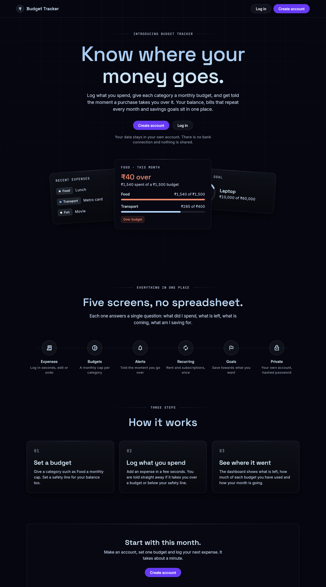
</p>

<table>
  <tr>
    <td width="50%"><br><sub><b>Sign in.</b> One centred glass card; the demo button sits under an OR divider.</sub></td>
    <td width="50%"><br><sub><b>Dashboard.</b> Verdict, banner, stats, budgets, ring, recent expenses.</sub></td>
  </tr>
  <tr>
    <td><br><sub><b>Expenses.</b> The alert appears the moment an expense crosses a budget.</sub></td>
    <td><br><sub><b>Add expense.</b> Amount, category pills, date, note.</sub></td>
  </tr>
  <tr>
    <td><br><sub><b>Budgets.</b> Spent, left and an Over / Within budget tag per category.</sub></td>
    <td><br><sub><b>Recurring.</b> Apply a month with one click; applying twice adds nothing.</sub></td>
  </tr>
  <tr>
    <td><br><sub><b>Goals.</b> Progress rings, add money, remove.</sub></td>
    <td><br><sub><b>Alerts.</b> Over budget and low balance are told in words and icons, not colour alone.</sub></td>
  </tr>
</table>

On a phone the top pill becomes a floating pill at the bottom of the screen:

<p align="center">
  
  &nbsp;
  
  &nbsp;
  
</p>

## License

Released under the [MIT License](LICENSE). The bundled fonts (Inter, Space Grotesk, JetBrains Mono) are open source under the SIL Open Font License; their licence texts sit next to them in `app/assets/fonts`.
