# Budget Tracker

A personal budget and expense tracker with accounts: a **FastAPI + SQLite** backend and a **Flutter** app (Android and web).

> A prototype for a small number of users: each person has their own account and sees only their own data. It is not built for scale.

## Features

| Screen | What it does |
| --- | --- |
| **Landing and login** | A short product page, then register, log in and log out. Passwords are stored hashed (scrypt, per-user salt), the session survives a reload, and every feature below works on the logged-in user's own data only |
| **Dashboard** | A one-line verdict ("You have ₹4,226 left, ₹774 below your safety line."), a warning banner when the balance is low, a stat strip, spent vs budget per category as bars, a budget-used ring, recent expenses and goals, month navigation, balance settings (opening balance and safety line) |
| **Expenses** | A table of the month with stats and category tabs; add with amount, category pills, date picker and note; instant overspend and low-balance alerts; click a row or **Edit** to change it; **Remove** deletes at once with an **Undo** |
| **Budgets** | Monthly cap per category as a bar with spent, left and an Over / Within budget tag |
| **Recurring** | Templates (e.g. rent on the 1st) applied to a month with one click; applying twice never duplicates |
| **Goals** | Savings goals with a progress ring; contributions reduce the balance |

Categories are case-insensitive (`Food` and `food` are the same category). Amounts are stored as integer paise and exposed as rupees, so there is no floating-point drift.

## Design

A calm, document-like interface: paper panels with thin borders on a pale blue-grey page, one cobalt accent for actions, and a highlighter yellow used sparingly for what matters (the logo mark, the avatar, the low-balance banner).

- **Layout:** a 240px sidebar on wide windows; on phones a top bar with scrolling section tabs. Pages open with a title, one sentence of explanation and their actions, then a strip of key figures.
- **Type:** Bricolage Grotesque for headings and interface, Source Serif 4 for the statement on the landing page (both bundled in `app/assets/fonts`, SIL Open Font License). Amounts use tabular figures so they line up.
- **Colour:** light and dark themes (a toggle on every screen, remembered between visits). Red is reserved for overspending and errors; amber for the low-balance warning.
- **Status is never colour alone:** over-budget and low-balance also use words and icons. Text scales with the system font size (tested at 2x). Every control is reachable by name for screen readers.
- **Honest loading:** free hosting puts the server to sleep, so the app keeps retrying and says "Waking up the server…" instead of failing.
- Amounts use Indian digit grouping (₹1,50,000) and drop the decimals when there are no paise.

## Demo

Try it with realistic data in about two minutes. The hosted build and the Docker image offer a **Use demo account** button on the login screen.

<p>
  
  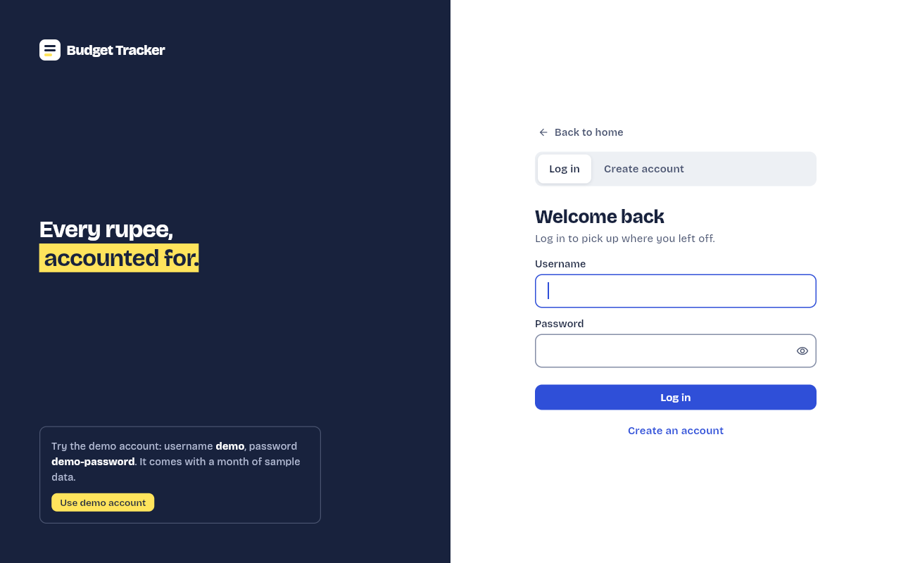
</p>
<p>
  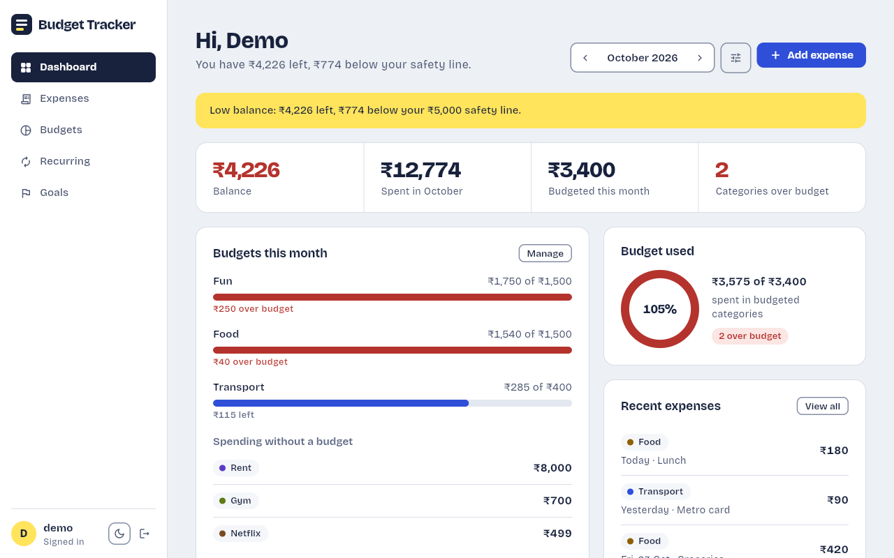
  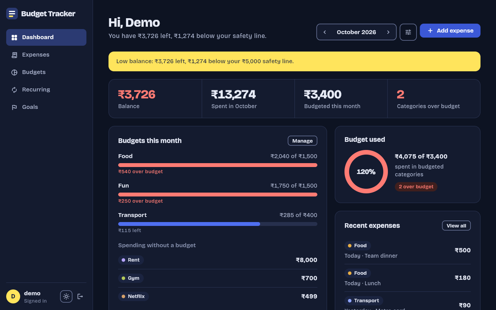
</p>
<p>
  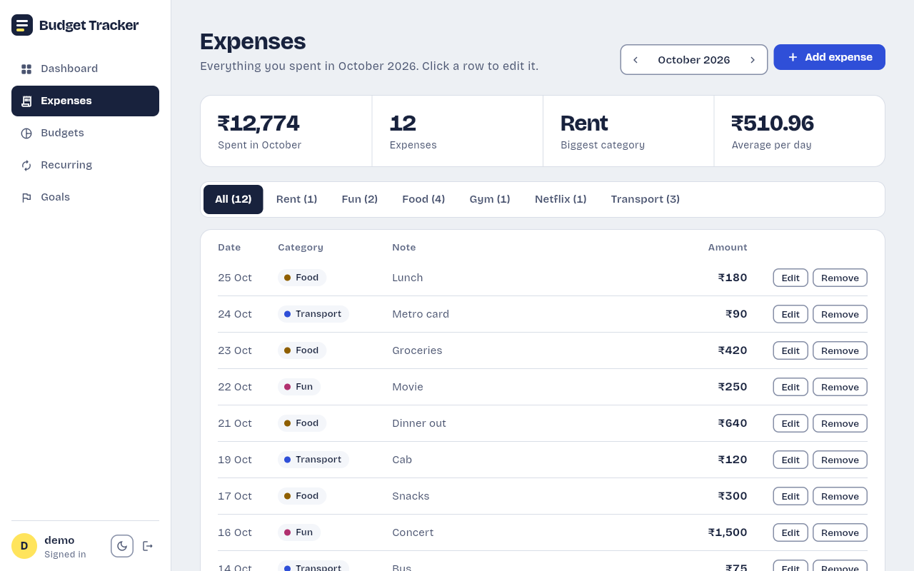
  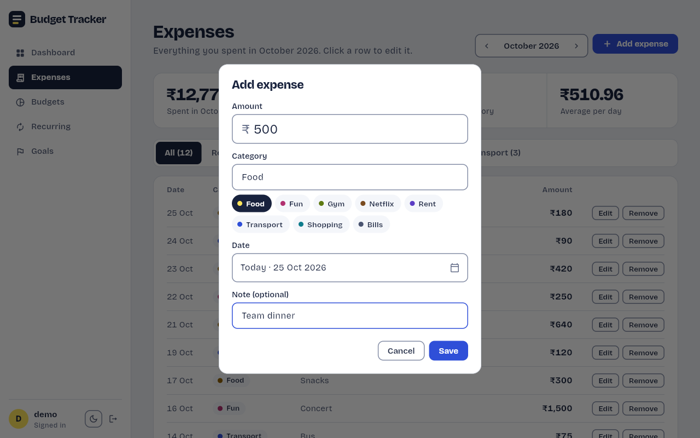
</p>
<p>
  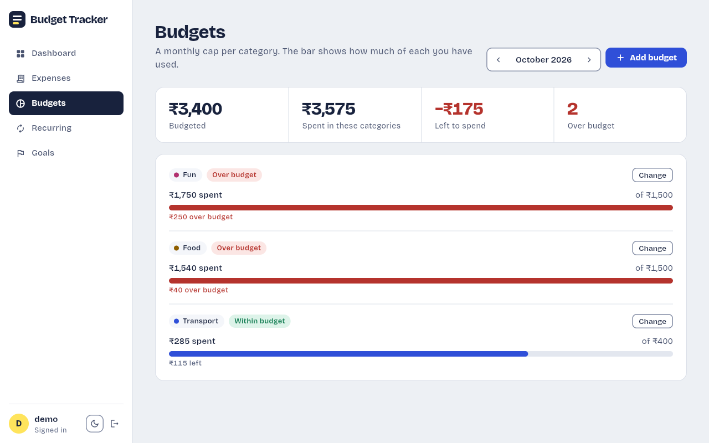
  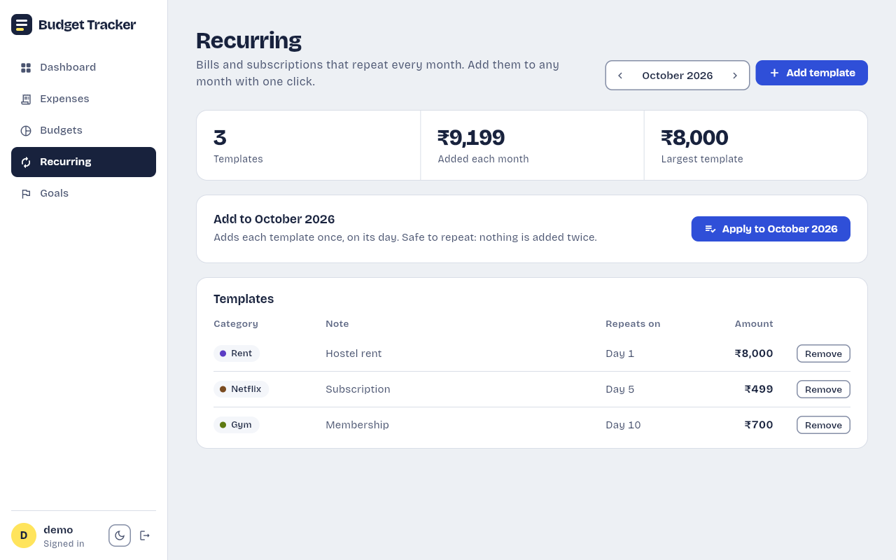
</p>
<p>
  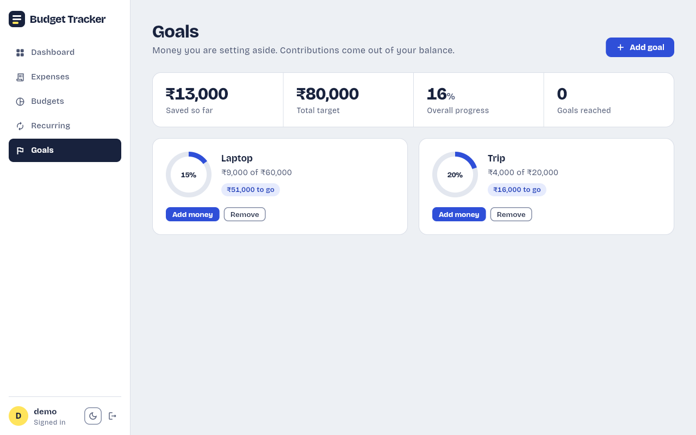
</p>
<p>
  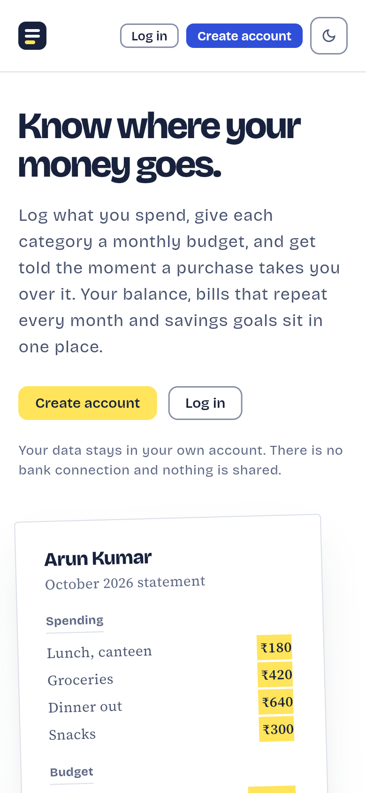
  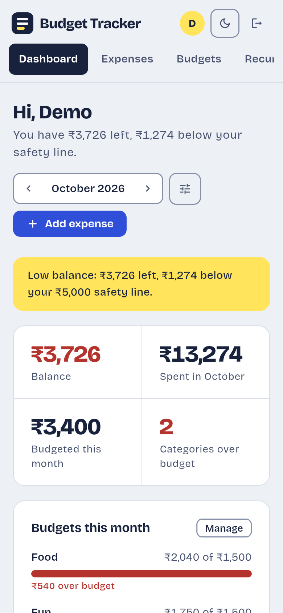
  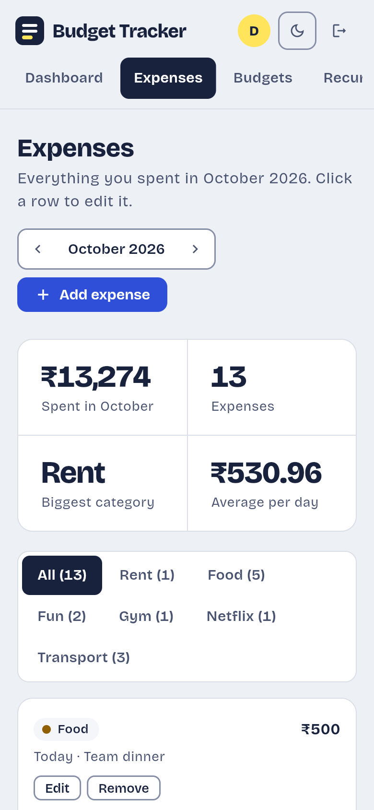
</p>

**1. Start the backend and load the demo account**

```bash
cd backend
pip install -r requirements.txt
uvicorn main:app --port 8000          # leave running
python seed_demo.py                    # in a second terminal
```

The seed script creates the account `demo` (password `demo-password`; change them with `--username` and `--password`) and fills the current month through the public API: a ₹30,000 opening balance, three budgets, nine expenses, three recurring templates (rent, Netflix, gym, already applied) and two savings goals. It refuses to add data to an account that already has some (`--force` overrides that). With Docker the container seeds the demo account itself on every start.

**2. Open the app** (see [App](#app) for setup)

```bash
cd app && flutter run -d chrome --dart-define=API_URL=http://127.0.0.1:8000 --dart-define=SHOW_DEMO=true
```

**3. Take the tour**

| Where | Try this | You should see |
| --- | --- | --- |
| **Landing** | Click **Log in** | The login form. **Use demo account** fills in `demo` / `demo-password` (or click **Create an account** to make your own) |
| **Dashboard** | Read the top of the page | "You have ₹4,226 left, ₹774 below your safety line." and a yellow low-balance banner. *Fun* and *Food* have full red bars marked "over budget"; *Transport* still has room |
| **Dashboard** | Click the sliders icon (Balance settings), set *Opening balance* to `40000`, Save | The warning goes away: "You have ₹14,226 left, ₹9,226 above your safety line." |
| **Dashboard** | Use the arrows by the month | Other months are empty; the arrows return you to this month |
| **Expenses** | Click **Add expense**, enter `500`, click the *Food* pill, Save | An alert: **Over budget in food by ₹540** |
| **Expenses** | Click **Remove** on a row | The expense is deleted at once and an **Undo** appears |
| **Expenses** | Click a row (or **Edit**), change the amount | The expense is updated, and the budget is checked again |
| **Budgets** | Click **Change** on *Food*, set the cap to `3000`, Save | Add the same `500` expense again: no alert any more |
| **Recurring** | Click **Apply to October 2026** (your current month) | "Nothing to add: ... is already up to date." Applying twice never adds duplicates |
| **Recurring** | Click **Add template**, enter `100` / `Netflix` / day `31`, Save | An inline message: "Pick a day from 1 to 28" |
| **Goals** | Click **Add money** on *Laptop*, add `1000` | "Added ₹1,000 to Laptop"; progress moves to ₹10,000 of ₹60,000 and the balance drops by ₹1,000 |
| **Anywhere** | Click the moon icon, then **Log out** | The dark theme (remembered); the landing page |

**Reset the demo:** stop the backend, delete `backend/budget.db` (with Docker: `docker compose down -v`), then start again and re-run the seed script.

## Repository layout

```
backend/            FastAPI app (main.py), pytest suite, demo seed script, Dockerfile
app/                Flutter source: lib/ (screens, theme, API client), test/, assets/fonts, Dockerfile
e2e/                Real-browser walkthrough of every page, README screenshot script
docs/img/           Screenshots used in this README
Dockerfile          Builds the app and the API into one image
docker-compose.yml  Runs that image locally on port 8000
render.yaml         Render blueprint (one Docker service)
```

Flutter platform folders (`android/`, `web/`, ...) are generated, not committed.

## Prerequisites

- Python 3.10+
- Flutter 3.35+ (Dart 3)
- Chrome, or an Android emulator, to run the app

## Backend

```bash
cd backend
pip install -r requirements.txt
pytest                                   # 39 tests
uvicorn main:app --host 0.0.0.0 --port 8000 --reload
```

- Interactive API docs: http://127.0.0.1:8000/docs
- The database is `backend/budget.db`. Set `BUDGET_DB=/path/to/file.db` to use another file.

### API summary

Every endpoint except `/auth/register` and `/auth/login` needs `Authorization: Bearer <token>` and only ever touches that user's data (another user's record is a 404). Sessions last 30 days.

| Method | Path | Purpose |
| --- | --- | --- |
| POST | `/auth/register`, `/auth/login` | Create an account / log in: both return a session `token` |
| POST / GET | `/auth/logout`, `/auth/me` | End the session / who am I |
| GET / PUT | `/account` | Opening balance, low-balance threshold, current balance |
| POST / GET | `/expenses` | Add (response includes `alert` and `low_balance`) / list (`month`, `category`) |
| PUT / DELETE | `/expenses/{id}` | Update (same response as add, so editing can alert too) / delete |
| PUT / GET | `/budgets` | Set a cap / list caps for a `month` |
| POST / GET | `/recurring` | Add / list templates |
| DELETE | `/recurring/{id}` | Delete a template |
| POST | `/recurring/apply?month=YYYY-MM` | Create the month's expenses; returns `{"created": n}` (0 on repeat) |
| POST / GET | `/goals` | Add / list goals |
| POST | `/goals/{id}/contribute` | Add savings to a goal |
| DELETE | `/goals/{id}` | Delete a goal |
| GET | `/dashboard?month=YYYY-MM` | Totals, per-category spent vs cap, daily trend |

## App

Generate the platform folders once (this does not touch `lib/` or `test/`):

```bash
cd app
flutter create . --project-name budget_tracker   # add --platforms=web,android,windows to pick targets
flutter pub get
```

Run it with the backend already up:

```bash
# Chrome
flutter run -d chrome --dart-define=API_URL=http://127.0.0.1:8000

# Android emulator (10.0.2.2 is the host machine)
flutter run --dart-define=API_URL=http://10.0.2.2:8000
```

The default `API_URL` is `http://10.0.2.2:8000`. On a physical device use your computer's LAN IP and start the backend with `--host 0.0.0.0`.

### Android: one extra step

`flutter create` only grants the `INTERNET` permission to *debug* builds, so a release APK cannot reach the API. After generating the platform folders, run:

```bash
python tool/patch_android.py --cleartext   # --cleartext only for a plain http:// API
```

It is safe to run repeatedly. Then build the APK:

```bash
flutter build apk --release --dart-define=API_URL=http://10.0.2.2:8000
# -> build/app/outputs/flutter-apk/app-release.apk
```

### Other builds

```bash
flutter build web --release --dart-define=API_URL=http://127.0.0.1:8000       # build/web
flutter build windows --release --dart-define=API_URL=http://127.0.0.1:8000   # Windows desktop (add --platforms=windows to flutter create)
```

## Docker

One container runs the whole app: the Flutter web app and the API, behind one port.

```bash
docker compose up --build
```

- App: http://localhost:8000
- API docs: http://localhost:8000/docs
- Demo data: the container creates the `demo` account on every start (log in with **Use demo account**)
- Data lives in the `budget-data` volume. `docker compose down -v` deletes it.

Without Compose: `docker build -t budget-tracker . && docker run -p 8000:8000 -v budget-data:/data budget-tracker`.

The `Dockerfile` has two stages. The first builds the Flutter web app with `API_URL=same-origin`, so the app talks to whatever server it was loaded from. The second is the API image, which serves that build at `/`. The first build downloads the Flutter SDK image, so it takes a few minutes.

To run the same thing without Docker: build the app with `flutter build web --dart-define=API_URL=same-origin`, copy `app/build/web` to `backend/web`, and start `uvicorn main:app`. The backend serves `backend/web` at `/` whenever it exists (override the folder with `WEB_DIR`).

## Deploy on Render (free tier)

Render builds the root `Dockerfile`, so one service gives you the app and the API at one URL.

1. On https://render.com choose **New > Web Service** (or **New > Blueprint** to use `render.yaml`) and select this repository.
2. Runtime **Docker**, repository root, default settings. No environment variables are needed.
3. Wait for the first build (several minutes: it downloads Flutter and compiles the app), then open the service URL. The app is at `/` and the API docs at `/docs`.
4. The login screen has a **Use demo account** button; the container creates that account when it starts.

Free-tier limits: the service sleeps after about 15 minutes idle (the first request then takes up to a minute; the app shows "Waking up the server…" and keeps retrying), and the filesystem is wiped on every restart or deploy, so accounts and data reset. The demo account is re-created on every start. Use it as a demo, not for real finances.

## Testing

```bash
# 1. Backend unit tests
cd backend && pytest

# 2. Start a throwaway backend for the Flutter tests
BUDGET_DB=/tmp/t.db uvicorn main:app --port 8000

# 3. Static analysis and tests
cd app
flutter analyze
flutter test --dart-define=API_URL=http://127.0.0.1:8000
```

| Test | Needs backend? | Covers |
| --- | --- | --- |
| `test/format_test.dart` | no | Money formatting (Indian grouping, paise), day and month labels, category colours |
| `test/widget_test.dart` | no | With nobody logged in the app opens on the landing page, and Log in opens the form |
| `test/ui_flow_test.dart` | no | Every screen against an in-memory stub of the API, on a desktop window and on a phone. Public pages and the theme toggle; accounts (log in, register with validation, wrong password, taken username, unreachable server, log out, expired session); the waking-server retry; dashboard, expenses (add, edit, Remove and Undo, filters), budgets, recurring and goals with their alerts, inline validation and empty states; system Back; 2x system text without overflow |
| `test/api_test.dart` | **yes**, port 8000 | The Dart API client against the real backend: accounts, login required, users isolated from each other, and the full feature flow. Registers its own users, so it can be re-run on any database |

### Full UI walkthrough (real browser)

`e2e/walkthrough.py` drives the compiled web app in a real browser through everything: the login and registration screens (including their validation and a wrong password), the landing page, every section, budgets (add and edit), expenses (add, edit, Remove with Undo, overspend and low-balance alerts), the dark theme, recurring templates (applied twice), goals, log out and back in, staying logged in after a page reload, and a second user who sees none of the first user's data. Each run registers its own users, so the database does not need to be empty.

```bash
pip install playwright && playwright install chromium

# build the app for a single server and put it next to the backend
cd app && flutter build web --dart-define=API_URL=same-origin --dart-define=SHOW_DEMO=true
cp -r build/web ../backend/web            # (Windows: xcopy /E /I build\web ..\backend\web)

# start the backend, which now serves the app too
cd ../backend && uvicorn main:app --port 8000

# in another terminal, from the repository root
BASE_URL=http://127.0.0.1:8000/ python e2e/walkthrough.py
```

It runs phone-sized by default; add `VIEWPORT_W=1280 VIEWPORT_H=800` for the desktop layout. Set `BROWSER_CHANNEL=chrome` to use an installed Chrome instead of Playwright's Chromium, and `SLOW=2` on a slow machine. The last full run passed 63 of 63 steps on both layouts.

## Releases

Tagged releases mark known-good states of `main`.
