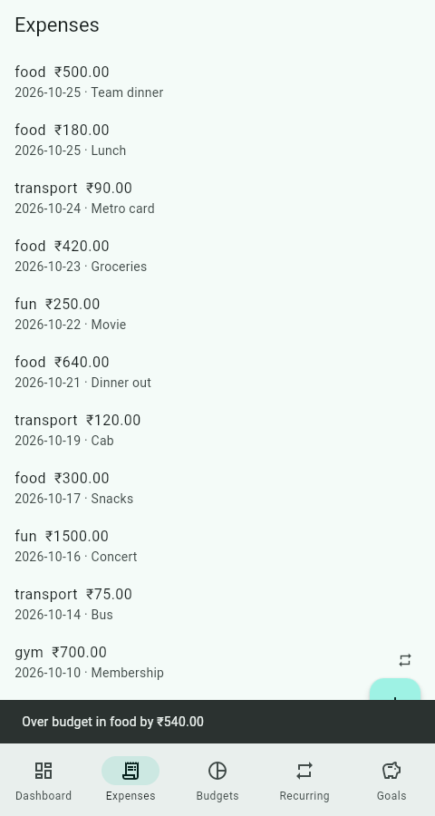

# Budget Tracker

A personal budget and expense tracker: a **FastAPI + SQLite** backend and a **Flutter** app (Android and web).

> Single-user prototype. There is no authentication and it is not built for scale.

## Features

| Tab | What it does |
| --- | --- |
| **Dashboard** | Balance, spent vs budget per category, daily spend trend, month navigation, opening balance and low-balance threshold |
| **Expenses** | Add an expense (amount, date, category, note), swipe to delete, instant overspend and low-balance alerts |
| **Budgets** | Monthly cap per category |
| **Recurring** | Templates (e.g. rent on the 1st) applied to a month with one tap; applying twice never duplicates |
| **Goals** | Savings goals with progress; contributions reduce the balance |

Categories are case-insensitive (`Food` and `food` are the same category). Amounts are stored as integer paise and exposed as rupees, so there is no floating-point drift.

## Demo

Try it with realistic data in about two minutes.

<p>
  
  
  
</p>
<p>
  
  
  
</p>

**1. Start the backend on a fresh database and load the demo data**

```bash
cd backend
pip install -r requirements.txt
uvicorn main:app --port 8000          # leave running
python seed_demo.py                    # in a second terminal
```

The seed script fills the current month through the public API: a ₹30,000 opening balance, three budgets, nine expenses, three recurring templates (rent, Netflix, gym, already applied) and two savings goals. It refuses to run on a database that already has data (`--force` overrides that). With Docker, run `docker compose exec api python seed_demo.py` instead.

**2. Open the app** (see [App](#app) for setup)

```bash
cd app && flutter run -d chrome --dart-define=API_URL=http://127.0.0.1:8000
```

**3. Take the tour**

| Where | Try this | You should see |
| --- | --- | --- |
| **Dashboard** | Look at the card and the bars | A red *Low balance* card (balance ₹4226 is under the ₹5000 threshold); *food* and *fun* in red with **Over budget**; *transport* still within its cap |
| **Dashboard** | Tap the gear, set *Opening balance* to `40000`, Save | The card turns normal: the balance is now above the threshold |
| **Dashboard** | Use the arrows by the month | Other months are empty; the arrows return you to this month |
| **Expenses** | Tap **+**, enter `500` and category `Food`, Save | A banner: **Over budget in food by ₹540.00** |
| **Expenses** | Swipe a row to the left | The expense is deleted and the dashboard updates |
| **Budgets** | Tap *food*, change the cap to `3000`, Save | Add the same `500` expense again: no alert any more |
| **Recurring** | Tap **Apply to this month** | **Already applied**. Applying twice never adds duplicates |
| **Recurring** | Tap **+**, add `100` / `Netflix` / day `31` | A validation message: the day must be 1-28 |
| **Goals** | Tap *Laptop*, contribute `1000` | Progress moves to ₹10,000 of ₹60,000 and the balance drops by ₹1,000 |

**Reset the demo:** stop the backend, delete `backend/budget.db` (with Docker: `docker compose down -v`), then start again and re-run the seed script.

## Repository layout

```
backend/            FastAPI app (main.py), pytest suite, demo seed script, Dockerfile
app/                Flutter source: lib/ (screens, API client), test/, Dockerfile
e2e/                Real-browser walkthrough of every page, README screenshot script
docs/img/           Screenshots used in this README
docker-compose.yml  Runs backend and web app together
```

Flutter platform folders (`android/`, `web/`, ...) are generated, not committed.

## Prerequisites

- Python 3.10+
- Flutter 3.35+ (Dart 3)
- Chrome, or an Android emulator, to run the app

## Backend

```bash
cd backend
pip install -r requirements.txt
pytest                                   # 10 tests
uvicorn main:app --host 0.0.0.0 --port 8000 --reload
```

- Interactive API docs: http://127.0.0.1:8000/docs
- The database is `backend/budget.db`. Set `BUDGET_DB=/path/to/file.db` to use another file.

### API summary

| Method | Path | Purpose |
| --- | --- | --- |
| GET / PUT | `/account` | Opening balance, low-balance threshold, current balance |
| POST / GET | `/expenses` | Add (response includes `alert` and `low_balance`) / list (`month`, `category`) |
| PUT / DELETE | `/expenses/{id}` | Update / delete |
| PUT / GET | `/budgets` | Set a cap / list caps for a `month` |
| POST / GET | `/recurring` | Add / list templates |
| DELETE | `/recurring/{id}` | Delete a template |
| POST | `/recurring/apply?month=YYYY-MM` | Create the month's expenses; returns `{"created": n}` (0 on repeat) |
| POST / GET | `/goals` | Add / list goals |
| POST | `/goals/{id}/contribute` | Add savings to a goal |
| DELETE | `/goals/{id}` | Delete a goal |
| GET | `/dashboard?month=YYYY-MM` | Totals, per-category spent vs cap, daily trend |

## App

Generate the platform folders once (this does not touch `lib/` or `test/`):

```bash
cd app
flutter create . --project-name budget_tracker
flutter pub get
```

Run it with the backend already up:

```bash
# Chrome
flutter run -d chrome --dart-define=API_URL=http://127.0.0.1:8000

# Android emulator (10.0.2.2 is the host machine)
flutter run --dart-define=API_URL=http://10.0.2.2:8000
```

The default `API_URL` is `http://10.0.2.2:8000`. On a physical device use your computer's LAN IP and start the backend with `--host 0.0.0.0`. For Android over plain HTTP, add `android:usesCleartextTraffic="true"` to the `<application>` tag in `android/app/src/main/AndroidManifest.xml`.

Build for the web:

```bash
flutter build web --dart-define=API_URL=http://127.0.0.1:8000
```

## Docker

Run the backend and the web app together:

```bash
docker compose up --build
```

- App: http://localhost:3000
- API and docs: http://localhost:8000 and http://localhost:8000/docs
- Data is kept in the `budget-data` volume. `docker compose down -v` deletes it.

The web image bakes the API address in at build time (`API_URL` in `docker-compose.yml`, default `http://localhost:8000`). It must be an address the *browser* can reach. To serve it from another host, change that value and rebuild.

> The Docker files have not been run through Docker (it wasn't available where this was developed). Their build steps were replayed natively and the base images verified to exist, but treat the first `docker compose up --build` as the real test.

## Testing

```bash
# 1. Backend unit tests
cd backend && pytest

# 2. Start a throwaway backend for the Flutter tests
BUDGET_DB=/tmp/t.db uvicorn main:app --port 8000

# 3. Static analysis and tests
cd app
flutter analyze
flutter test --dart-define=API_URL=http://127.0.0.1:8000
```

| Test | Needs backend? | Covers |
| --- | --- | --- |
| `test/widget_test.dart` | no | App shell and tab navigation |
| `test/ui_flow_test.dart` | no | Every tab's flows against an in-memory stub of the API: alerts, validation, readable server errors, recurring apply twice, goals, retry on network failure |
| `test/api_test.dart` | **yes**, port 8000 | The Dart API client end to end against the real backend |

### Full UI walkthrough (real browser)

`e2e/walkthrough.py` drives the compiled web app in a real browser through every page: empty states, month navigation, account settings, adding/editing/deleting budgets, expenses (including swipe-to-delete, overspend and low-balance alerts, validation errors), recurring templates (applied twice), goals, and the final balance arithmetic. It needs a **fresh** database.

```bash
pip install playwright && playwright install chromium

# terminal 1: backend on a FRESH database
cd backend && uvicorn main:app --port 8000

# terminal 2: build and serve the web app
cd app && flutter build web --dart-define=API_URL=http://127.0.0.1:8000
python -m http.server 8123 --directory build/web

# terminal 3: run the walkthrough from the repository root
BASE_URL=http://127.0.0.1:8123/ python e2e/walkthrough.py
```

Set `BROWSER_CHANNEL=chrome` to use an installed Chrome instead of Playwright's Chromium, and `SLOW=2` on a slow machine. The last full run passed 37 of 37 steps.

## Releases

Tagged releases mark known-good states of `main`.
